# Pocket-Game-Maker User Guide

Version 0.9.7 · 13 November 2026 · Pocket-Designs

Pocket-Game-Maker is a desktop editor for making monster-taming and monster-catching RPGs: you paint maps, place people and events, fill a database of monsters, moves and items, then press **Playtest** to play the game in its own window. This guide walks through every part of the editor and the game it produces.

Pocket-Game-Maker was called MonsterForge before version 0.8.1. Projects made with the old name open as before, and the first time you start Pocket-Game-Maker it moves your asset library folder and recent projects list across.

## 1. Getting started

### Installing

1. Double-click **Pocket-Game-Maker-Setup-0.9.7.exe**.
   - If you received Pocket-Game-Maker as several files ending in `.bin` plus **Join-Pocket-Game-Maker-Setup.bat**, put them all in one folder and double-click the `.bat` file instead. It puts the installer back together and starts it.
2. If Windows says it **protected your PC**, click **More info**, then **Run anyway**. This appears because the installer isn't digitally signed.
3. Choose where to install Pocket-Game-Maker, or keep the suggested folder, and click **Install**.
4. When it finishes, Pocket-Game-Maker has a shortcut on your Desktop and in the Start menu.

From then on, open Pocket-Game-Maker from its shortcut. To remove it, go to **Settings → Apps**, find Pocket-Game-Maker and choose **Uninstall**. Your game projects are kept.

**On a Mac,** open `Pocket-Game-Maker-<version>-mac.dmg` and drag Pocket-Game-Maker into Applications. It runs on Intel and Apple Silicon Macs. If the copy you have isn't signed, right-click the app and choose **Open** the first time; if macOS says it is damaged, run `xattr -cr /Applications/Pocket-Game-Maker.app` in Terminal.

**On Linux,** either install the `.deb` file (Ubuntu, Debian, Mint and similar) or make the `.AppImage` file executable and double-click it.

### The welcome screen

When no project is open you see three things:

- **New project…** creates a project.
- **Open project…** opens an existing project folder.
- **Recent projects** lists up to eight projects you opened before. Click one to reopen it.

### Creating a project

1. Click **New project…** (or press `Ctrl+N`).
2. Type a **Game title**.
3. Choose what to start from:
   - **Sample project**: two maps, 10 monsters, 17 moves, 10 items, three starter choices, a singles trainer, a doubles trainer and wild encounters. Best for learning.
   - **Blank project**: keeps the types, items, starter tileset and character sprites, but has no monsters, moves or events and one empty 20×15 map.
4. Click **Choose folder & create** and pick a parent folder, such as `Documents\Games`. Pocket-Game-Maker makes a new folder inside it named after your title.

The folder must not already exist with files in it. Leave Include the free asset library ticked to copy every library tileset, character, monster and background into the new project (section 7).

### Opening and saving

- **Open project…** (`Ctrl+O`): pick your game's folder, the one named after its title.
- **Save** (`Ctrl+S`): writes everything to disk. The bottom-right of the window shows **● Unsaved changes** in orange until you save.
- If you close the window with unsaved changes, Pocket-Game-Maker asks before quitting.

## 2. The editor window

The editor has five areas: a toolbar across the top, the tileset and map list on the left, the map in the middle, the inspector on the right and a status bar along the bottom.

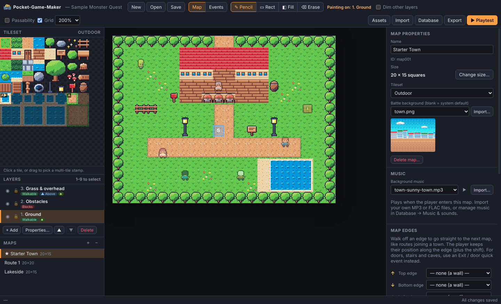

| Area | Where | What it's for |
| --- | --- | --- |
| Toolbar | Top | Project buttons (New, Open, Save), the **Map / Events / Height** mode switch, painting tools, the layer you are painting on, Dim other layers, Passability and Grid toggles, zoom, Assets (the free asset library), Import (your own files), Export, **Database** and **▶ Playtest**. |
| Tileset palette | Left, top | The tiles of the current map's tileset. Click one to paint with it, or drag across several to paint a block of tiles. |
| Layers panel | Left, middle | The map's layers, top layer first. Click one to paint on it; use the eye and padlock to hide or lock it; add, reorder, delete and change layer settings with the buttons underneath (section 3). |
| Maps list | Left, bottom | Every map in the project with its size. The start map has a ★. Click to open a map; right-click to rename, duplicate, reorder or delete it. － deletes the selected map and **＋** adds a new map. |
| Map canvas | Centre | The map you are editing. Hold `Ctrl` and scroll the mouse wheel to zoom. |
| Inspector | Right | In Map mode: the map's properties (name, size, tileset, battle background), its music, its map edges and its wild-encounter table. In Events mode with an event selected: that event's name, position and a summary of each page. |
| Status bar | Bottom | The tile under the mouse (X, Y, layer, tile number, passable or blocked, encounters, event name) and whether you have unsaved changes. |

The light-blue square marked **S** on the map is where the player starts a new game.

## 3. Map mode: building maps

Map mode (`M`) is where you paint the world. Pick tiles in the palette, choose a tool and a layer, then click or drag on the map.

### Painting tools

| Tool | Key | What it does |
| --- | --- | --- |
| ✎ Pencil | `B` | Paints the selected tile, or block of tiles, where you click. Hold the mouse button and drag to keep painting. |
| ▭ Rect | `R` | Drag a rectangle; it fills with the selected tiles when you let go. A multi-tile selection repeats as a pattern. |
| ◧ Fill | `F` | Fills every connected tile that matches the one you clicked, on the current layer only. |
| ⌫ Erase | `X` | Clears one tile on the current layer. |
| Right-click |  | Picks up the tile under the mouse (an eyedropper) and switches to the Pencil. |

Undo with `Ctrl+Z` and redo with `Ctrl+Y`. Pocket-Game-Maker remembers the last 100 changes, including fills and map resizes.

### Layers

Every map is built from **layers** stacked on top of each other. A map always has at least three, and you can add as many more as you need. Each layer has its own settings, so one layer can be solid walls while another is grass the player walks through.

The **Layers** panel on the left, under the tileset, lists them with the top layer first. Click a layer to paint on it, or press its number key (`1` to `9`). The toolbar shows which layer you are painting on, and tiles you paint only go on that layer.

New maps start with these three layers:

| Layer | Use it for | Collision | Drawn above the player | Wild encounters |
| --- | --- | --- | --- | --- |
| 1. Ground | Grass, paths, floors | Always walkable | No | Where the tile is marked ♣ |
| 2. Obstacles | Walls, trees, boulders, fences, water, furniture | Always blocks | No | Never |
| 3. Grass & overhead | Tall grass, flowers, tree tops, roof edges | Always walkable | Yes | Where the tile is marked ♣ |

Small coloured badges under each layer's name show its settings at a glance: green **Walkable**, red **Blocks**, blue **▲ Above**, and ♣ when it has wild encounters.

**Layer properties**

Double-click a layer, or select it and click **Properties…**, to change its settings:

- **Name**: anything that helps you, such as "Roofs" or "Invisible walls".
- **Collision**: *Always walkable* (never blocks), *Always blocks* (anything painted on it blocks the player) or *Use each tile's setting* (uses the ○ and × flags from Database → Tilesets). If any layer blocks a square, the player can't walk there.
- **Drawn above the player and characters**: the layer is drawn over the player, for tree tops, roofs and tall grass that hides their feet.
- **Wild encounters**: *Never*, *Where the tile is marked ♣*, or *On every tile painted here* (paint any tile on the layer to mark out an encounter patch).
- **Hidden in the game**: the layer isn't drawn when playing, but it still blocks and starts encounters. Use it for invisible walls.
- **Visible**, **Locked** and **Opacity while editing** only change what you see in the editor. Visible and Locked are also the eye and padlock buttons beside each layer.

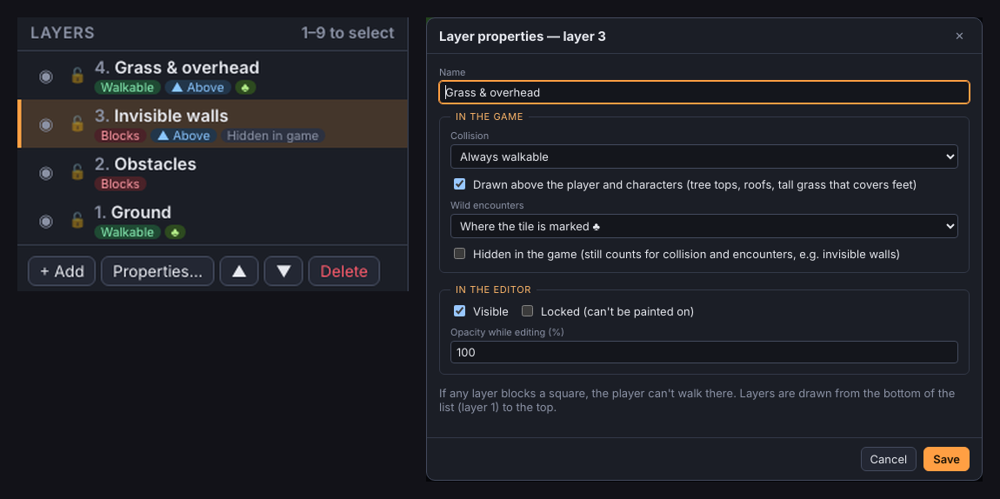

**Adding and arranging layers**

- **+ Add** puts a new layer above the selected one and opens its properties. New layers start as walkable and drawn above the player.
- **▲** and **▼** move the selected layer up or down. Layers higher in the list are drawn on top.
- **Delete** removes the selected layer and everything painted on it, after asking you first. You can also right-click any layer and choose Delete layer. You can delete any layer, including the three a new map starts with, until only one is left.
- Adding, moving, deleting and changing layers can all be undone with `Ctrl+Z`.
- Tick **Dim other layers** in the toolbar, or press `D`, to fade every layer except the one you're painting on. You can't paint on a locked or hidden layer. The map gets a faint blue tint while you paint on a layer that's drawn above the player.

Maps made in older versions of Pocket-Game-Maker keep working exactly as before. Their layers are named Ground, Obstacles and Above player, and the first two use each tile's own setting.

### Seeing passability

Tick **Passability** (`P`) to check your map. Blocked squares turn red and wild-encounter squares turn green. The palette also shows each tile's flag: ○ walkable, × blocked, ☆ walkable and drawn above the player, ♣ encounter tile. You set these flags in the Database (section 5).

### Autotiles and animated tiles

Some tiles join up by themselves. An **autotile**, such as the water and dirt path in the Outdoor tileset, works out its own edges and corners: paint a patch of any shape and the shoreline or grass edge is drawn around it, including the inside corners of L-shapes. Paint over it, or erase part of it, and the edges redraw.

Some tiles also move. The Outdoor water ripples in the game. Animated tiles only move when you playtest; the editor shows their first frame.

In the tileset palette, autotiles are marked **A** and animated tiles **▶**. The darker tiles next to them are the other pieces of the same autotile, or its later animation frames. Clicking any of them picks the whole autotile, so you always paint with the right one.

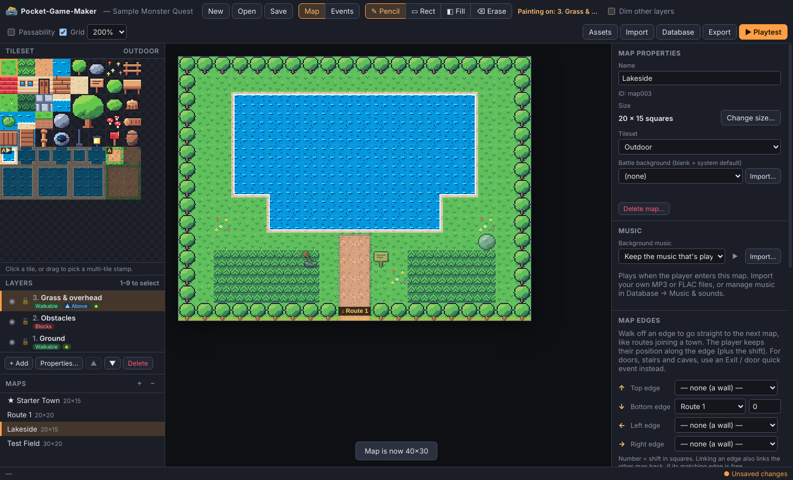

To set up your own autotiles and animations, see **Database → Tilesets** (section 5).

### Managing maps

- **New map:** click **＋** in the Maps list. Give it a name and a tileset, then pick a size: **Small** (20×15), **Medium** (30×20), **Large** (40×30), **Huge** (64×48), or type any width and height from 5 to 256 squares. The window tells you how many squares fit on the game screen at once. Leave *Fill the ground layer* ticked to start with grass everywhere.
- **Right-click a map** in the list to rename it, change its size, duplicate it, move it up or down, playtest, or delete it.
- **Delete map:** select the map and click **－** in the Maps list, click **Delete map…** at the bottom of its properties in the inspector, or right-click it. Before deleting, Pocket-Game-Maker lists any transfers and map edges that lead to it. If the game starts on that map, the start position (and the blackout point, if it was there) moves to a walkable square near the middle of the next map; set it again where you want it. Deleting a map can't be undone with `Ctrl+Z`, so if you change your mind, close the project without saving. A project always keeps at least one map.
- **Change size…** (in the inspector, or right-click the map): pick a new size, then use the 3×3 grid to choose which part of the map stays where it is. The top-left square adds or removes squares on the right and bottom; the bottom-right square adds or removes them on the top and left; the middle square grows or shrinks the map evenly. Events, the start position and encounter areas move with the map, and new ground is filled in from the nearest edge. Press `Ctrl+Z` to undo it.
- **Tileset:** each map uses one tileset, chosen in the inspector.
- **Battle background:** the picture shown behind battles on this map. Leave it at (none) to use the default from the System tab.
- **Music:** the background music for this map, with a ▶ button to listen. *Keep the music that's playing* lets the last map's music carry on, which suits a house inside a town. *Silence* stops the music.

### Moving between maps

There are two ways to take the player to another map. Use whichever suits the place.

**Map edges: walk off the side of a map.** This joins outdoor areas, such as a town and the route beside it. In the inspector's **Map edges** section, pick a map for the top, bottom, left or right edge. When the player walks off that edge, they arrive on the matching edge of the other map, at the same position along it. If the two maps don't line up, set the number next to the edge to shift the player sideways (for top and bottom edges) or up and down (for left and right edges).

- Linking an edge also links the other map back, as long as its matching edge isn't already used. Pocket-Game-Maker tells you when it does this.
- Linked edges show as a yellow band with the other map's name along that side of the map.
- Leave a gap in the trees or walls where the player should cross, and make sure the squares on both sides can be walked on.

**Exit / door: step on a square, or open a door.** This suits doorways, stairs, cave entrances and anywhere the two places aren't side by side. In Events mode, right-click the square and choose **Quick event: Exit / door**, then choose:

- **How it works:** *Walk onto the square* for doorways, stairs and cave mouths, or *Face it and press the action button* for a door the player opens.
- **Go to map**, **X**, **Y** and **Facing**. The window shows the size of the map you picked, so you know which numbers are valid. *Keep facing* leaves the player facing the way they walked.
- **Play the door sound** and **Fade to black**.

Land the player one square away from the other map's own exit, or they'll be sent straight back.

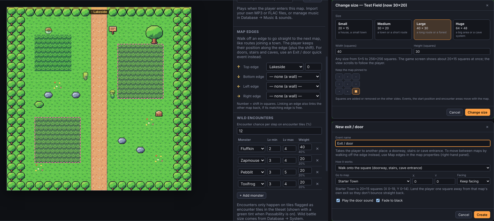

In the sample project, walking north off Route 1 takes you to Lakeside, and the two squares at the bottom of Route 1 are exits back to Starter Town.

### Wild encounters

The **Wild encounters** box in the inspector controls which monsters appear in this map's tall grass, caves or water.

- **Encounter chance per step**: the percentage chance of a battle each time the player steps onto an encounter tile. 8–15% feels like classic games.
- **Encounter table**: one row per monster, with the lowest and highest level it can appear at and a **Weight**. Weights are relative, and the small percentage under each shows its actual share. For example, weights 40, 20, 20, 20 give 40%, 20%, 20%, 20%.
- **+ Add monster** adds a row; ✕ removes one.

Battles only start on encounter squares: a tile flagged ♣ in the tileset on a layer set to *Where the tile is marked ♣*, or anything painted on a layer set to *On every tile painted here* (see Layers above). The player also needs a monster that can fight. How many wild monsters appear at once is set in **Database → System → Battle rules**.

To give one part of a map different monsters, such as a rare corner of the grass, use a **monster encounter area** quick event (section 4).

### 2.5D: hills, cliffs and the tilted camera

Any map can have **height levels**, from 0 (the ground) up to 4, and a **tilted camera** that leans the ground away from the player. Raised ground gets a cliff face on its front, characters stand on top of it and walk behind it, and everyone casts a small shadow. Maps without heights and with the top-down camera look and play exactly as before.

**Height mode.** Click **Height** on the toolbar (or press `H`). The Heights panel on the right has:

- **Level 0–4:** pick a level, then paint it on the map. Right-click a square to pick its level.
- **Raise** and **Lower:** move the ground up or down one level.
- **Stairs:** paint stairs; click stairs again to remove them. Stairs join two squares one level apart.
- **Flatten:** back to level 0, with no stairs. **Flatten all** does the whole map.
- **Brush:** paint 1×1, 2×2 or 3×3 squares at a time.

Levels show as colours (blue 1, yellow 2, orange 3, red 4) with their number, and thick dark lines show cliff faces. In Map and Events mode only the cliff lines show, so you can still see the shape of the land. Undo, redo and **Change size…** keep the heights.

**Drag and drop shapes.** Drag a ready-made shape from the Heights panel onto the map: **Small hill**, **Big hill**, **Plateau**, **Cliff wall**, **Jump-down ledge**, **Stairs up** or **Lookout**. Its top-left corner goes where you drop it, and it rises from the level of that square, so a hill dropped on a plateau goes one level higher. You can also click a shape, then click the map.

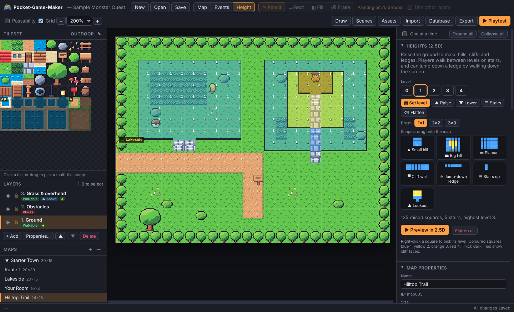

**How players move between levels:**

- Squares of the same level: walk as normal.
- One level up or down: only on **stairs**.
- Down a ledge while walking **down the screen**: the player **jumps** down, with a jump sound. They can't climb back up the same way.
- Anything else is a cliff, like a wall.
- People and objects can only be talked to from the same level, or across stairs.

**Map properties → 2.5D view** sets how the game shows the map:

| Setting | Choices |
| --- | --- |
| Camera | Top-down (classic) or Tilted 2.5D (the ground leans away) |
| Tilt | Slight, Medium or Strong (tilted camera) |
| Mist in the distance | None, Light, Medium or Heavy (tilted camera) |
| Height of each level | ¼, ½, ¾ or a whole square |
| Cliff faces | Rock, Earth, Stone wall, Wood or Grassy bank |
| Beyond the edge of the map | A colour: sky for outdoors, black for a cave |
| Players can jump down ledges | On or off |
| Characters cast shadows | On or off |

**▶ Preview in 2.5D** (in the panel and the 2.5D view section) playtests the map straight away. The playtest debugger warns about stairs that don't join two levels and events nobody can reach, and its F10 overlay shows each square's level.

The sample game's **Hilltop Trail**, east of Lakeside, shows it all: a plateau with a jump-down ledge, a three-level hill with a lookout at the top, and the tilted camera.

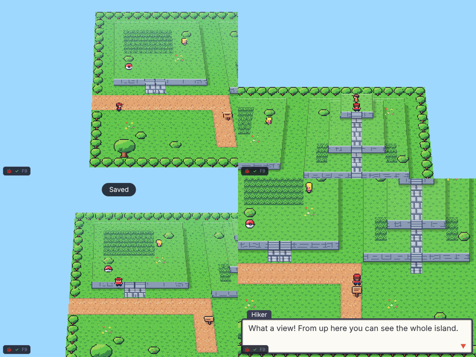

## 4. Events mode: people, items and story

An **event** is anything on a map that does something: a person who talks, a trainer who battles, an item on the ground, a sign, a door or a map exit. Switch to Events mode (`E`) to place and edit them.

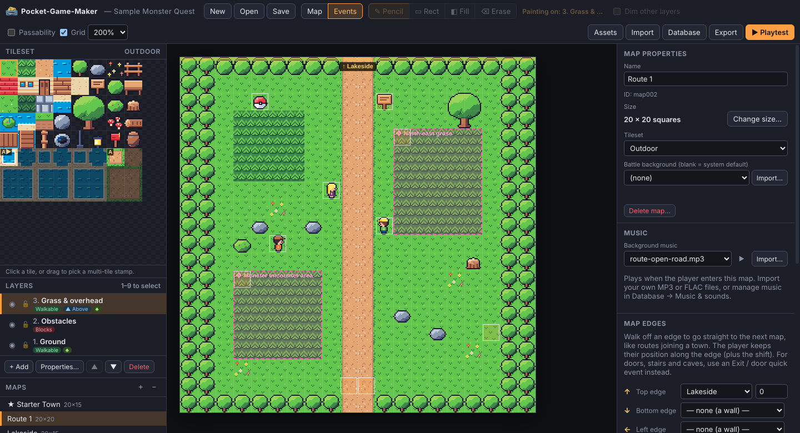

### Placing and arranging events

- **Double-click** an empty square to create an event; the event editor opens straight away.
- **Click** an event to select it, and **drag** it to move it. Two events can't share a square.
- **Double-click** or press `Enter` on a selected event to edit it. `Delete` removes it.
- `Ctrl+C` copies the selected event. Right-click an empty square and choose **Paste event** to place a copy.
- **Right-click** any square for: New event here, Edit, Copy, Paste, Delete, **Set player start here** and **Playtest from here**.

### Quick events

Nine common events can be made in one step without building pages by hand. In Events mode, right-click an empty square and choose a **Quick event**, fill in the small window, then click **Create**.

| Quick event | What you can set | What happens in the game |
| --- | --- | --- |
| **Treasure chest** | An item and how many, or an amount of money; the message when it opens; the message when it's empty; the closed and open sprites | The player presses Z, the chest opens, your message shows and the contents go into the bag. It stays open and shows the empty message after that. |
| **Item on the ground** | Any item and how many; the message; visible with a sprite, or hidden | The player presses Z on it, gets the item and it disappears. Hidden items have no sprite, so the player has to face the square and press Z to find them. |
| **Sign** | A title shown above the message, the message itself, a sign post sprite or invisible, and whether it can only be read from the front | The player presses Z and the message shows. Leave an empty line in the message to split it into separate boxes. "Only from the front" means the player must stand below the sign, facing up. |
| **Monster encounter area** | The area's size; the monsters that can appear, with level ranges and how often each appears; the chance of a battle per step; how many appear at once; an optional message; tall-grass-only; once only | While the player walks inside the area, wild battles use this list instead of the map's. See below. |
| Shopkeeper | Sprite and facing; greeting and goodbye; the items for sale, each at its normal price or a price for this shop only; whether the player can sell items here, and for what percentage of their price | The player presses Z and the shop opens: Buy, Sell or Leave. See Shops below. |
| Exit / door | Walk onto the square, or face it and press the action button; the map, square and facing to arrive at; door sound; fade to black; a sprite for doors | The player is taken to the other place. See Moving between maps in section 3. |
| Person (NPC) | Sprite, name and facing; how they move (stand still, wander, look around, or walk a set route) and how fast; and what they do: talk, give an item once, or battle once | See People (NPCs) below. |
| Switch / lever | The game switch it controls; sprites for OFF and ON; messages; a sound; one way or both ways | The player presses Z to flip it, turning the switch ON or OFF. See Switches and levers below. |
| Cut scene | Whether it starts when the player steps into an area (and how big the area is) or when the map opens; the first line of the scene | Plays when the player steps into an area, arrives on the map, talks to it, or when a switch turns on. A movie, or a scene built from your game. See Cut scenes below. |

Leave the message blank to use an automatic one, such as "You opened the chest and found 2× Super Potion!". The window shows what it will say.

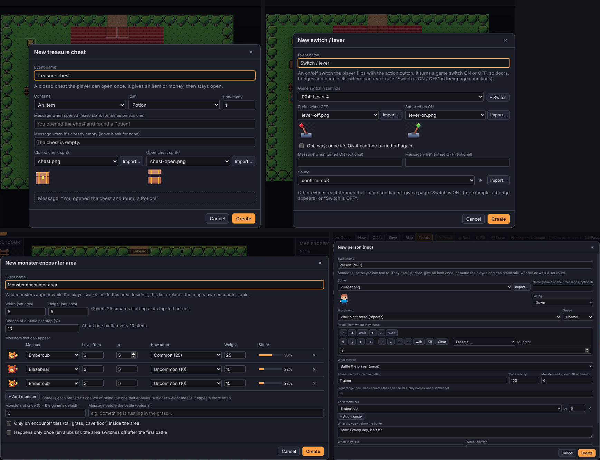

- **Change it later:** double-click the event, or select it and press `Enter`, to reopen the same window with its settings.
- **Need more?** Click **Full event editor** to see the pages behind it, for example to add a switch condition. If you change those pages by hand, the event becomes a normal event and opens in the full editor from then on.
- **Sprites are added for you.** If your project doesn't have the chest, open chest, capture orb or sign post sprite yet, Pocket-Game-Maker copies it from the asset library.

The sample project has one of each: a chest beside Starter Town's house, the shopkeeper at the bottom of Starter Town, the Starter Town and Route 1 signs, the Great Orb on Route 1, a hidden Potion near Route 1's south-east corner, Route 1's two south exits, and an encounter area on Route 1.

### Monster encounter areas

An encounter area gives part of a map its own wild monsters: rarer monsters deep in a forest, a cave corner with its own species, or a one-off ambush on a path. While the player is inside the area, its list replaces the map's encounter table. Everywhere else, the map's table still applies.

**To make one:**

1. In Events mode, **drag across the squares** you want to cover. A blue box shows your selection. For a single square, skip this step.
2. **Right-click inside the selection** and choose **Quick event: Monster encounter area**.
3. Add the monsters that can appear. For each one, set the lowest and highest level and **How often** it appears.
4. Set the **chance of a battle per step**, then click **Create**.

The area shows on the map as a pink dashed box with its name. Its event sits on the square you right-clicked; drag that square to move the whole area. Double-click it to change the settings.

**How often a monster appears** is set by its weight. Each monster's chance is its weight divided by the total of all the weights, and the **Share** column shows the result as you type. The presets are:

| How often | Weight |
| --- | --- |
| Very common | 40 |
| Common | 25 |
| Uncommon | 10 |
| Rare | 4 |
| Very rare | 1 |

For example, Zapmouse (Common, 25), Pebblit (Common, 25) and Sproutle (Rare, 4) give shares of 46%, 46% and 7%. You can also type any weight yourself. A weight of 0 means the monster never appears.

**Other settings:**

- **Chance of a battle per step:** 10% is about one battle every 10 steps; 100% starts a battle on every step, which is useful for ambushes.
- **Monsters at once:** 1 for a normal battle, 2 or more for a wild horde. 0 uses the game's setting in Database → System.
- **Message before the battle:** shown just before the battle starts, such as "Something is rustling in the grass…"
- **Only on encounter tiles:** battles only start on tall grass, rough cave floor and other tiles marked ♣ inside the area. Leave it off to start battles on any square in the area, including paths and floors.
- **Happens only once:** the area switches itself off after its first battle. Use it with a 100% chance for a scripted ambush.

The sample project's Route 1 has an encounter area over the north-east tall grass. It has Zapmouse and Pebblit at levels 4–6 and a rare Sproutle, which you won't find in the rest of Route 1's grass.

### Pages: how an event changes over time

Every event has one or more **pages**. Each page has its own look, behaviour and commands. When the game decides which page to use, it picks the **highest-numbered page whose conditions are all met**. If no page qualifies, the event disappears.

That is how events change as the story moves on. A trainer's page 1 battles you; page 2 only applies once its self switch is on, so after you win they just chat. Use **+ New page**, **Copy page** and **Delete page** above the page settings.

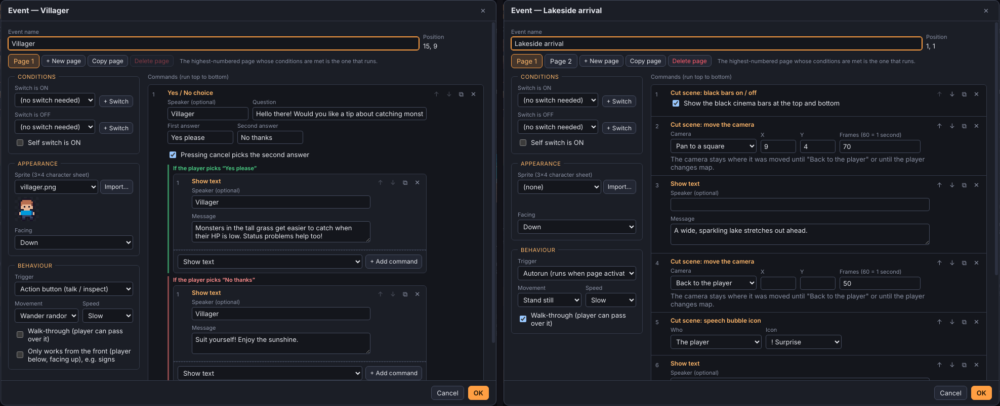

### Page settings

**Conditions**

- **Switch is ON**: the page only applies when this global switch is on. Switches are game-wide on/off flags such as "Chose starter". Click **+ Switch** to create and name a new one.
- **Switch is OFF:** the page only applies while this switch is off. Use it for things that disappear when a switch turns on, such as a boulder that a lever moves.
- **Self switch is ON**: the page only applies when this event's own private switch is on. Each event has one, so it's perfect for one-off things like an item you've picked up or a trainer you've beaten.

**Appearance**

- **Sprite**: the character sheet to draw. Leave it at (none) for invisible events such as signs on a signpost tile, doorways and map exits.
- **Facing**: which way the sprite looks. For trainers this is also the direction they watch.

**Behaviour**

| Trigger | When the page runs |
| --- | --- |
| Action button | The player faces the event and presses `Z`. Use it for people, signs and items. |
| Player touch | The player steps onto the event or walks into it. Use it for exits, doors and traps. |
| Trainer sight | The player walks into the trainer's line of sight. The trainer shows **!**, walks up to the player, then the page runs. **Sight range** is how many squares they can see in their facing direction; walls and other events block their view. |
| Autorun | Runs by itself as soon as the page becomes active. It must switch itself off, for example with a self switch and a second page, or it repeats forever. |

- **Movement**: Stand still, Wander randomly, Turn randomly, or **Walk a set route**, and a **Speed** (normal, slow or fast). A route is a list of steps the event repeats: click the arrows to add a step, the dotted arrows to turn without moving, and *wait* to pause; click a step to remove it. **Presets** fill in common patterns: back and forth left and right, back and forth up and down, walking around a square, or standing and looking around. If something is in the way, the event waits a moment and then skips that step. The selected event's route is drawn on the map in Events mode.
- **Walk-through**: lets the player pass over the event. Events with a sprite block the player unless this is ticked; events with no sprite never block.

### Commands

Commands run from top to bottom. Pick one in the dropdown at the bottom of the list and click **+ Add command**. Use ↑ ↓ to reorder, ⧉ to duplicate and ✕ to delete. **Cancel** throws away every change you made in the event editor; **OK** keeps them.

| Command | Settings | What happens |
| --- | --- | --- |
| Show text | Speaker (optional), message | Shows a message box. Long messages split into several boxes automatically. |
| Yes / No choice | Speaker, question, the two answers, whether cancel picks the second answer, and a list of commands for each answer | Asks the question and runs the commands for the answer the player picks. See below. |
| Give monster | Monster, level, nickname | Adds a new monster to the party, or to Storage if the party is full, and marks it caught in the DB. A short jingle plays. |
| Give / take item | Item, amount | Adds items to the bag. A negative amount takes them away. A short jingle plays when items are given. |
| Give / take money | Amount | Adds money, or takes it away if negative. |
| Heal party | None | Restores HP, EP and status for every monster in the party, with the healing jingle. |
| Set switch (on / off) | Switch; ON, OFF or flip | Changes a global switch. Flip turns it ON if it was OFF and OFF if it was ON. Events update immediately. |
| Set self switch | ON/OFF | Changes this event's own switch. |
| Transfer player | Map, X, Y, facing (or keep facing), fade or instant, door sound | Moves the player to another map or elsewhere on this one. |
| Open shop | Greeting, goodbye, items for sale and their prices, whether the player can sell, sell price % | Opens a shop. See below. |
| Open a screen | Wardrobe, Decorate, monster storage, Monsters, Bag, the monster database or Save | Opens that screen, for example a wardrobe in the player's room. Wardrobe and Decorate only open when the feature is on (section 10). |
| Play music | Music file and volume, or nothing to stop the music | Changes the background music until the next map with its own music, or the next Play music. |
| Play sound | Sound file and volume, and whether to wait for it to finish | Plays a sound effect. Choose a jingle from music/ and tick *wait* to pause the music while it plays. |
| Cut scene: move a character | Who (the player, this event, another event by name, or the following monster), the steps, speed, wait until finished, walk through anything | Walks them along the steps. Untick *wait* to let several characters move at once. |
| Cut scene: speech bubble icon | Who, and the icon: ! ? ♪ ♥ … ✶ 💢 zz | Shows the icon above them for about a second. |
| Cut scene: move the camera | Pan to a square (X, Y), or back to the player; how many frames it takes | Slides the view smoothly. The camera stays put until it's sent back or the player changes map. |
| Cut scene: screen effect | Fade out or in (black or white), flash, shake, or tint (dawn, dusk, night, sepia, grey, none); how long | Changes the whole screen. A tint stays until another tint (or *none*) replaces it. |
| Cut scene: show / hide a picture | Picture number 1–5, the picture, centre / fill the screen / at X, Y, opacity, fade frames | Shows a picture over the map, such as a flashback or a character portrait. Higher numbers show on top. |
| Cut scene: black bars on / off | On or off | Slides black cinema bars in at the top and bottom of the screen, or out again. |
| Trainer battle | Name, active per side, prize money, party, defeat and victory lines, battle background, battle music, story-battle option | Starts a trainer battle. See below. |
| Wild battle (scripted) | Monster, level, can run, can capture | Starts a battle with a specific wild monster, such as a legendary. |
| Wait | Frames (60 = 1 second) | Pauses before the next command. |
| Erase event | None | Hides this event until the player leaves the map. |

**Trainer battle settings in detail**

- **Active per side**: how many monsters each side has out at once. 1 is singles, 2 doubles, 3 triples. 0 uses the default from the System tab.
- **Party**: the trainer's monsters and levels, up to your maximum party size.
- **Defeat line**: what the trainer says when you beat them. **Victory line**: what they say if you lose.
- **Prize money**: paid to the player on a win.
- **Story battle**: if ticked and the player loses, the event carries on instead of the player blacking out. Use it for rival battles you're allowed to lose.

If the player loses a normal trainer battle, the event stops and the player blacks out (section 8). Put **Set self switch ON** after the battle so the trainer doesn't fight again.

### Yes / No choices

A **Yes / No choice** asks the player a question with two answers. Type the question, and change the answers if you like, such as "Yes please" and "No thanks". Underneath are two lists of commands, one for each answer; add commands to them just like the main list. A list can even hold another choice, so conversations can branch more than once.

Tick *Pressing cancel picks the second answer* so that X or Esc counts as "No". Untick it to make the player choose.

Example: the Villager in Starter Town asks if you'd like a tip.

### Shops

A shop sells items for money and, if you allow it, buys items back. Make one with the **Shopkeeper** quick event, or add an **Open shop** command to any event.

- **Items for sale:** add each item. Leave *Price in this shop* empty to use the item's normal price from Database → Items, or type a different price for this shop.
- **Selling:** tick *Player can sell items* and set the sell price as a percentage of the item's price (50% by default). Key items and items with no price can't be sold.

In the game, the player chooses **Buy**, **Sell** or **Leave**. After choosing an item they pick how many with the arrow keys (up and down change it by 1, left and right by 10) and confirm the total. Their money shows in the top-left corner throughout.

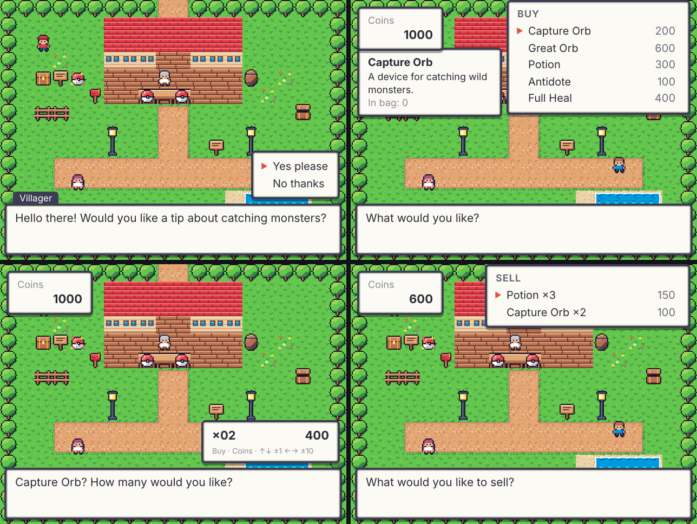

### People (NPCs)

The **Person (NPC)** quick event makes someone for the player to meet. Choose their sprite, an optional name for their messages, and which way they face, then:

- **Movement:** stand still, wander randomly, look around, or **walk a set route** (built the same way as in the event editor above) at normal, slow or fast speed.
- **What they do:**
  - **Talk:** shows your message.
  - **Give an item (once):** says your message and gives the item. Talk to them again and they say your *afterwards* line instead.
  - **Battle the player (once):** a trainer battle with the monsters you list. With a **sight range**, they spot the player in front of them (even while walking their route), show "!", walk over and battle; with a sight range of 0 they only battle when spoken to. Afterwards they say your *afterwards* line.

In the sample, the Jogger runs laps in Starter Town, the Gardener gives you a Super Potion, and Hiker Hugo patrols Route 1.

### Switches and levers

Switches are on/off flags for the whole game, such as "Chose starter". Events use them to change: a page can need a switch to be **ON** or to be **OFF**, and the **Set switch** command turns one ON, OFF or flips it.

The **Switch / lever** quick event is a lever the player flips with the action button. It turns its switch ON (and OFF again, unless it's *one way*), changes its sprite, and can play a sound and show a message. A new lever gets a new switch of its own; rename it in Database → System → Switches.

To make something react, give it a page with the condition *Switch is ON* (for example, a bridge that appears) or *Switch is OFF* (for example, a boulder that disappears). In the sample, the lever at Lakeside moves the boulder to the east.

### Cut scenes

A cut scene is an event that takes control for a moment to tell part of the story. Right-click a square in Events mode and choose **Quick event → Cut scene**. The window has two parts: when the scene plays, and the scene itself.

**When it plays**

| Starts | Use it for |
| --- | --- |
| When the player steps into an area | Something happens as the player walks somewhere. The area is shown as a light-blue dashed box; set its width and height. |
| As soon as the player arrives on this map | An arrival scene, or an opening scene on the map where the game starts. |
| When the player talks to it or examines it | A person who tells a story, or an object that plays something, like a TV. Choose a sprite, or leave it empty for an invisible spot. |
| When a switch turns ON | Story moments: the scene starts as soon as another event (or a battle you win) turns the switch on. |

Scenes started by stepping or talking can play **once** or **every time**; the others always play once. **When it has finished, turn this switch ON** lets other events react afterwards: people move, a door opens, or the next scene starts.

**The scene**

Choose **Built from your game** or **A movie file**.

- **Built from your game:** add steps with one click: 💬 Text, 🚶 Move someone, ❗ Bubble, 🎥 Camera, 🌗 Fade / flash / shake, 🖼 Picture, 🎵 Music, 🔊 Sound, ⏱ Wait, 🎬 Movie and ⏻ Switch. Steps play from top to bottom; reorder, copy or delete them with the buttons on each one. Move someone and Bubble work on the player, this event, or any event on this map by its name, so place the people in the scene on the map first. Untick *Wait until finished* on a move to make several characters walk at the same time. Tick **Black cinema bars** for a film look.
- **A movie file:** choose a movie or click **Import…** (MP4 or WebM). Choose whether the player can skip it (any key or a tap), what happens to the music (pause it and carry on afterwards, stop it, or keep it playing underneath), the volume, and whether the whole movie shows with black bars or fills the screen.

Click **▶ Preview** to watch it: a playtest opens with the player next to the event and the scene starts straight away. **Create** (or **Save**) keeps it.

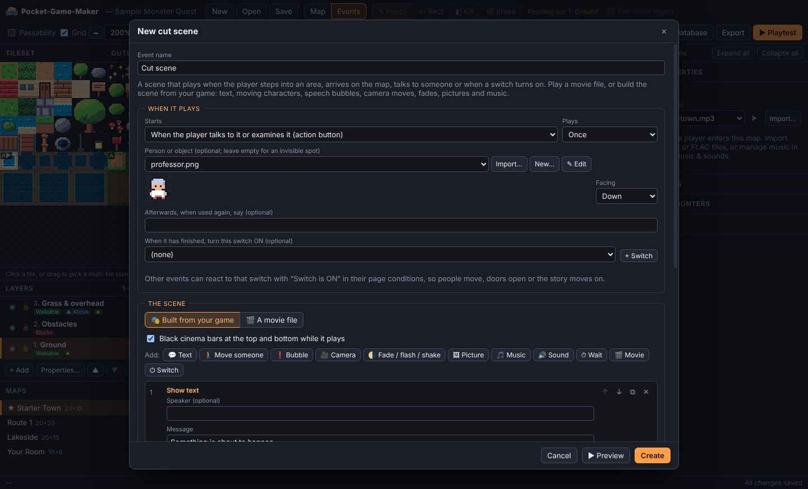

**Movies.** Add movie files with **Import → Movies** (or **File → Import Assets**); they go in the project's `assets/movies` folder and are listed in Database → Credits. MP4 with H.264 video and AAC sound plays everywhere a game runs, including phones and Safari; WebM plays on computers and Android. The **Cut scene: play a movie** command plays one from any event, too.

In the sample, arriving at Lakeside for the first time pans the camera over the lake, and the television in Your Room plays *Monster News*, a short movie from the asset library.

## 5. The Database

The Database (`F9`, the **Database** button, or the **Database** menu in the menu bar) holds everything that isn't a map: monsters, moves, types, items, tilesets and game-wide settings. Changes apply as you type; click **Done** to close it.

The **Database** menu in the menu bar lists every tab (Monsters, Moves, Types, Items, Tilesets, Music & sounds, Menus & screens, World map, System and Credits), so you can open the one you want directly. Each has a shortcut: `Ctrl+Shift+1` for Monsters through `Ctrl+Shift+9` for Credits (World map has no shortcut). If the Database is already open, the menu switches tab.

Most tabs have a list on the left with a **Filter** box, **+ New**, **Duplicate** and **Delete**. Deleting something other parts of the game use, such as a move in a learnset, warns you first. You can rename anything at any time; maps and events that use it keep working.

### Monsters

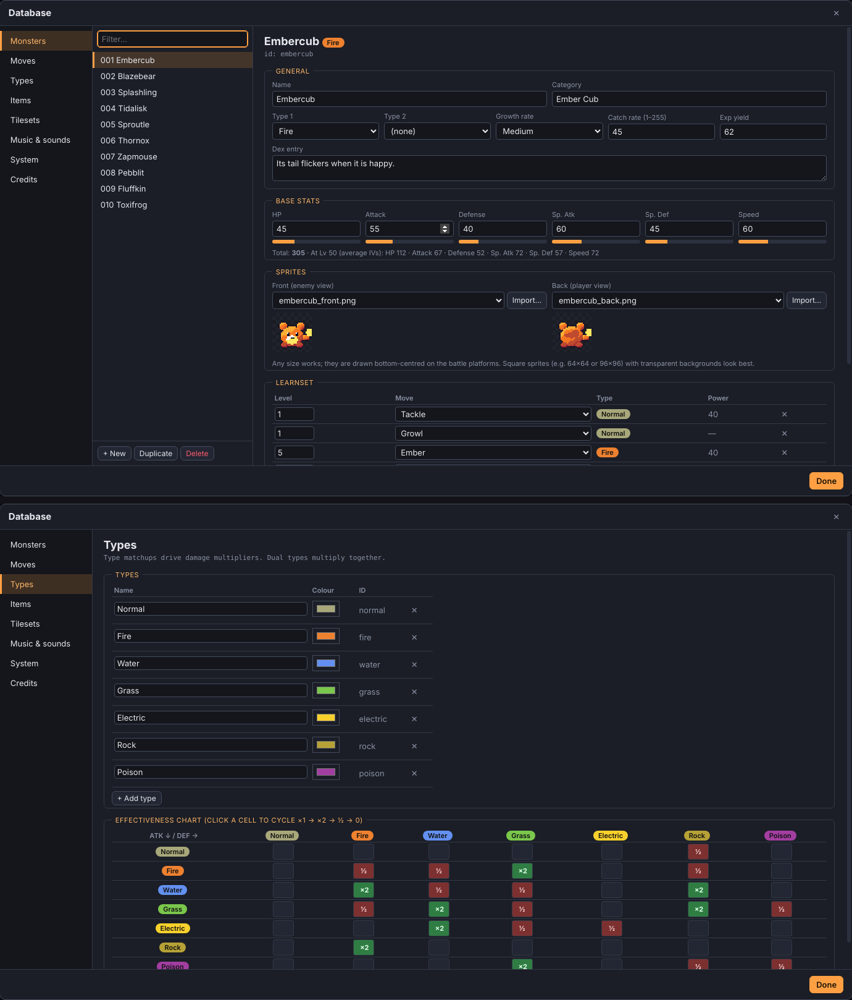

| Field | What it means |
| --- | --- |
| Name, Category | The species name and its DB category, e.g. Embercub, "Ember Cub". |
| Type 1, Type 2 | One or two types. Type 2 can be (none). |
| Growth rate | How much experience it needs to level up: Fast, Medium, Slow or Erratic. Fast monsters level up about 20% quicker than Medium, and Slow ones about 25% slower. |
| Catch rate (1–255) | Higher is easier to catch. 255 is very easy, 45 is starter-like and 3 is legendary. |
| Exp yield | How much experience it gives when defeated. Scales with its level. |
| DB entry | The description shown in the DB (the in-game monster database). |
| Base stats | HP, Attack, Defense, Sp. Atk, Sp. Def and Speed, usually between 20 and 150. The line below shows the total and what the stats work out to at level 50. |
| Sprites | The **Front** image is seen when it's an enemy; the **Back** image when it's yours. |
| Walking sprite | Optional 3×4 character sheet used when this monster follows the player. Without one, its front picture hops along instead. |
| Learnset | Which move it learns at which level. A newly created monster knows its most recent moves up to the move limit, usually 4. |
| Evolution | Does not evolve, evolves **At a level**, or evolves **When an item is used** (such as a Fire Stone). Pick what it evolves into. |

Each monster also gets small hidden random bonuses to its stats when it's created, so two of the same species at the same level differ slightly.

### Moves

| Field | What it means |
| --- | --- |
| Type | Decides type effectiveness, and the 1.5× same-type bonus when a monster uses a move of its own type. |
| Category | **Physical** uses Attack against Defense; **Special** uses Sp. Atk against Sp. Def; **Status** does no damage. |
| Power | Base damage. 40 is a starter move; 90+ is strong. |
| Accuracy % | Chance to hit. 0 means it never misses. |
| EP (Energy Points) | How many times it can be used before healing. |
| Priority | Higher priority goes first regardless of Speed. Quick Jab in the sample has priority 1. |
| Targets | One opponent, All opponents, the User, or One ally or self. Moves hitting more than one opponent do 75% damage to each. |
| Effect | None; **Inflict status** with a chance; **Change a stat stage** (−6 to +6, on the target or the user); **Heal** a % of max HP; **Drain** a % of the damage dealt; **Recoil** a % of the damage dealt. On a damaging move the effect is a bonus after the hit. |

### Types

Add, rename, recolour and delete types at the top. The chart below sets matchups: rows are the attacking type, columns the defending type. Click a cell to cycle **×1 → ×2 → ½ → 0**. Against a monster with two types the multipliers multiply, so ×2 against both types is ×4.

### Items

| Kind | Settings |
| --- | --- |
| Capture ball | Catch multiplier. 1 is a basic ball, 1.5 better; 255 always catches. |
| Healing / status cure | HP healed (a flat amount and/or a % of max HP) and which status it cures (one, all, or none). |
| Revive | Brings back a fainted monster with this % of its HP. |
| EP restore | EP restored to every move. |
| Evolution item | Has no effect by itself. Set it on a monster's Evolution section. |
| Tool | What it opens when used from the bag: monster storage, the DB, the party screen or the save screen. For example, a Storage Box (in the sample) lets players reach storage from their bag. |
| Key item | Story items with no effect. |

Every item also has a **Price**, a description, and whether it can be used **in battle** and **from the field menu**. Prices aren't used yet, because shops aren't in this version.

### Tilesets

A tileset is an image cut into a grid of square tiles. Set its **Tile size** in pixels (16, 24, 32 or 48), choose or import the **Image**, set the **Animation speed** for any animated tiles (milliseconds per frame; 300 is a gentle ripple), then flag each tile:

- **Passability mode**: click a tile to cycle ○ walkable → × blocked → ☆ walkable and drawn above the player.
- **Encounter tiles mode**: click a tile to toggle ♣. Wild monsters appear on these, such as tall grass, cave floor or water.
- **Autotiles & animation mode:** click a tile to make it an autotile, an animated tile, or both.
  - **Autotile:** the tile you click is the top-left of a block 2 tiles wide and 3 tall, laid out like RPG Maker's A2 autotiles: the top row is a preview tile and the inside corners, and the 2×2 tiles below are a patch with its edges and corners. RPG Maker A2 autotiles can be used as they are.
  - **Animation frames:** 2 to 8. The frames sit side by side to the right of the tile (two tiles apart for an animated autotile) and play back and forth.
- **Tile names mode:** click a tile to name it. Names show when you point at tiles in the palette.

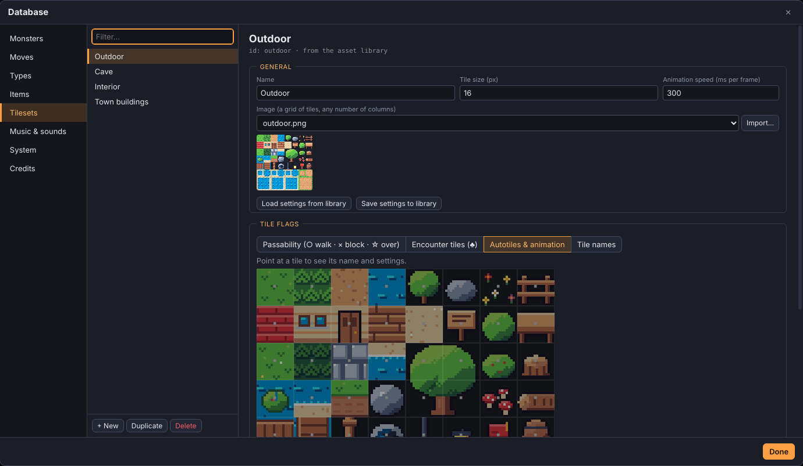

### Music & sounds

This tab sets every piece of music and every sound in the game. Each choice has a ▶ button to listen and an **Import…** button for your own files. Pocket-Game-Maker plays **MP3** and **FLAC** files.

| Section | What it sets |
| --- | --- |
| Volume | Music volume and sound effect volume, as percentages. |
| Game music | The title screen, wild battles, trainer battles, and the victory music after winning. Music loops without a gap. |
| Jingles | Short tunes that play once while the background music pauses: healing the party, getting an item, and catching or receiving a monster. |
| Sound effects | 20 sounds: the menu cursor, confirm, cancel, not allowed, hits, strong hits, fainting, throwing a ball, the ball shaking, catching, breaking free, level up, running away, a wild battle starting, doors, bumping into walls, buying and selling, healing items, saving and jumping down a ledge. Choose (silent) for none. |
| Files in this project | Every music and sound file in the project, with its credit status and licence. |

If the project has no music yet (for example, one made with an older version), click **Add the free presets** to copy Pocket-Game-Maker's own music and sounds into it.

After a battle, the map's music carries on from where it left off.

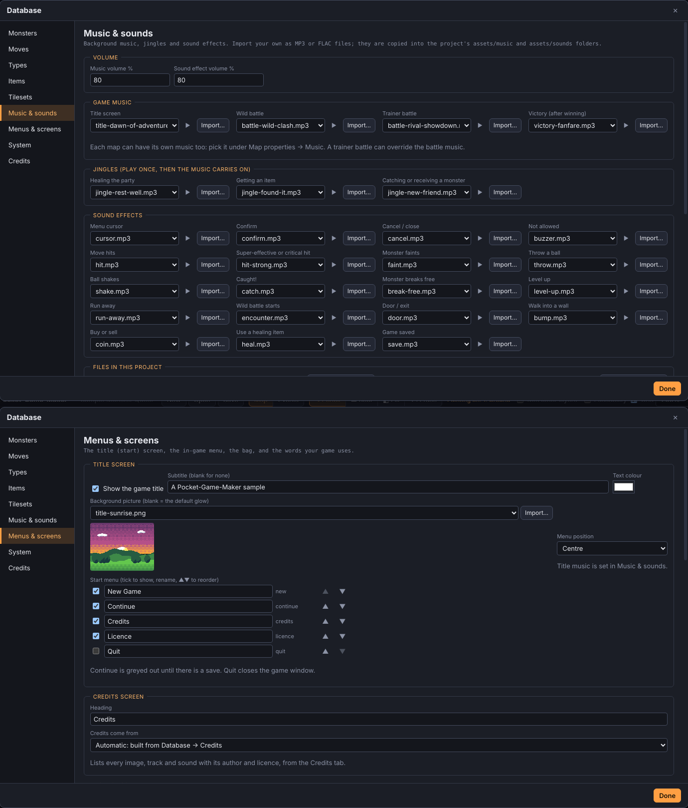

### Menus & screens

This tab sets the screens your players see outside the map: the start menu, the credits and licence, the in-game menu and the bag, plus the words your game uses.

| Section | What you can change |
| --- | --- |
| Title screen | Show or hide the game's title, a subtitle, the text colour, a background picture (from `assets/pictures`), and where the menu sits (centre, bottom or left). The **start menu** lists New Game, Continue, Credits, Licence and Quit: tick the ones to show, rename them, and use ▲ ▼ to change the order. |
| Credits screen | Its heading, and where the credits come from: **Automatic** lists every image, track and sound from the Credits tab with its author and licence; **My own credits file** shows a text file you choose. |
| Licence screen | Its heading, and the text file with your game's licence or terms. |
| In-game menu | The menu the player opens with X: tick, rename and reorder DB, Monsters, Bag, Storage, Save and Close, and choose whether it shows the player's money. |
| Bag shortcuts | Screens that appear at the top of the bag: Storage, the DB, Monsters or Save. For example, tick Storage here and untick it in the in-game menu so storage can only be reached from the bag. |
| Words used in the game | The short and full names for the monster database (**DB** and **Database** by default) and for move energy (**EP** and **Energy Points**). Change them to suit your game. |
| Following monster | Make the first monster in the party walk behind the player, and choose whether the player can talk to it. |

For the credits and licence files, click **Import .txt / .md…** to bring in a file you already have, or **Write one…** to type it here; it's saved in the project's `assets/text` folder. A line starting with `#` becomes a heading and a line starting with `-` a bullet point. The box underneath shows the start of the file.

### System

| Section | Settings |
| --- | --- |
| Game | Title, currency name, starting money, and screen size. The game draws at **width × height** and is enlarged by **Window scale**; 320×240 at ×2 suits 16 px tiles. |
| Player | Default name, walk speed (1–8) and sprite. |
| Start position | The map, X, Y and facing for a new game. Quicker: in Events mode, right-click a square → Set player start here. |
| Blackout | Where the player wakes up, and the message shown, when all their monsters faint. |
| Starting party & bag | Monsters and items the player begins with. The sample starts with an empty party because the player picks a starter. |
| Battle rules | Max party size (default 6), moves per monster (4), max level (100), **Wild battle size**, **Trainer battle size**, critical-hit chance and multiplier, same-type bonus, exp multiplier, trainer exp bonus, and whether players can run from trainers. |
| Status immunities | Which types can't be poisoned, burned, paralysed or put to sleep. In the sample, Fire can't be burned. |
| Default battle background | Used on maps that don't set their own. |
| Switches | Name your global switches here. Names are only there to help you; players never see them. |

### The title screen and Options

In **Database → Menus & screens → Title screen** you can show the game's name or your own **logo** picture, add a subtitle and a background, choose where the menu sits and its **style** (a window, or plain words over the picture), and add a blinking **"Press any key"** line before the menu appears. Tick, rename and reorder the start menu's entries: **New Game, Continue, Load Game, Options, Replay Opening, Credits, Licence and Quit**.

- **Continue** loads the latest save straight away, or (if you choose) asks which save to load. **Load Game** always asks.
- **Options** lets players set the music and sound volume and the text speed (slow, normal, fast or instant). Their choices are kept on their own computer or phone. Options is also in the in-game menu.
- **Replay Opening** appears only when the game has opening scenes (see *Opening and ending scenes* below).

### Saving

**Database → Menus & screens → Saving** decides how players save:

- **Number of save slots:** 1 to 12. Tick **Ask before saving over a slot** to confirm overwrites.
- **From the menu:** the in-game menu's **Save** entry (tick or untick From the in-game menu).
- **Save points:** the **Save point** quick event makes a bed, a diary or a save crystal. It asks first (or not), can heal the party, then opens the save screen or saves quietly. The window shows how many save points the project has.
- **From the bag:** **+ Add a “Journal” save item** makes a Tool item that opens the save screen, and puts it in the starting bag.
- **Autosave:** saves into its own **Autosave** slot when the player arrives on a new map, after winning a battle, and/or every few minutes, with an optional "Saved" note. Players load the autosave like any other slot.

The event command **Save the game** (save point) opens the save screen, or saves quietly into the Autosave slot. In the sample, the bed in Your Room is a save point, and the game autosaves each time you arrive on a new map.

### Bag pockets

**Database → Menus & screens → Bag pockets** splits the bag into pockets, like a Potions pocket, a Capture Orbs pocket and a Key Items pocket. Players switch pocket with ← and →.

- **Add**, rename, reorder (▲ ▼) and remove (✕) pockets, and give each an icon.
- Tick which **item kinds** go in each pocket. Each kind belongs to one pocket. One pocket takes **everything else**.
- To remove battle items, untick their kind from every pocket, or delete the pocket; to add a Potions pocket, add one and tick Healing and Revive.
- An item can choose its own pocket: **Items → Bag pocket** (or leave it on Automatic).
- Untick **The bag has pockets** for one simple list. **Reset** to the starting pockets brings back the standard ones.

### World map

**Database → World map** gives the game a map of its world, opened from the menu (**Map**), a **Town Map** item, or the **Open a screen** event command.

1. Tick **Players have a world map** and give it a title.
2. Choose a picture: click one of the three ready-made maps (**Island**, which matches the sample, **Continent** or **Old parchment map**), import your own picture, or draw one in the pixel editor.
3. **Click the picture to add a place**, and drag a pin to move it. For each place, write its name and a short description, and tick the **game maps** that count as being there (for example a town and the houses in it).
4. Optionally tick **Travel** and give each place a **travel destination** (a map and square). Players can then go straight to places they have already visited.
5. Choose whether places the player hasn't visited yet show as **???** or are hidden. Click **+ Add a Town Map item** to make an item that opens the map.

In the game the map shows a pin for each place: "You are here", places visited and places not yet visited. The arrow keys choose a place, Z travels there, X closes the map. The playtest debugger warns about a world map without a picture, places with no game maps, and travel destinations that don't exist.

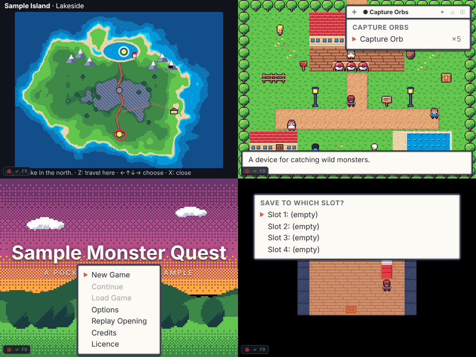

### Opening and ending scenes

The **Scenes** menu in the menu bar (**Opening & Ending Scenes…**, `Ctrl+Shift+O`), or the **Scenes** button on the toolbar, opens a window with three lists. Each list plays its scenes in order:

| List | When it plays |
| --- | --- |
| Before the title | When the game starts, before the title screen: a studio logo, an intro movie, a story. **Replay Opening** on the title screen plays it again. |
| New game starts | After the player picks New Game, before the first map: a prologue or a welcome. |
| Ending & credits | When an event uses the command **Play the ending (or other story scenes)**, for example after the final battle. Choose what happens afterwards: back to the title screen, or carry on playing. |

Add as many scenes as you like with **+ Add scene**. There are four kinds:

- **Movie:** an MP4 or WebM file, fitted to the screen or filling it, with its own volume. The game's music pauses, or keeps playing under it.
- **Picture slides:** pictures with captions, one after another. Each slide stays for some seconds, or until the player presses Z; slides fade or cut.
- **Story text:** text that scrolls up like a film's opening crawl, or appears a page at a time (start a new page with a line of `---`).
- **Credits roll:** built from your credits list (Database → Credits) or written yourself, with a heading and words at the end such as *The End*.

Every scene can change the music (or stop it), use a background colour or picture and a text colour, and let players skip it with X, Esc or a long tap. In text, `#` starts a big heading, `##` a small one, `-` a list item, and `**two stars**` make bold words. Use ▲ ▼ to change the order, **Duplicate** to copy a scene, and untick **Play this scene** to keep it without playing it. **▶ Preview** plays one scene in a playtest, and **▶ Play all** plays the whole list.

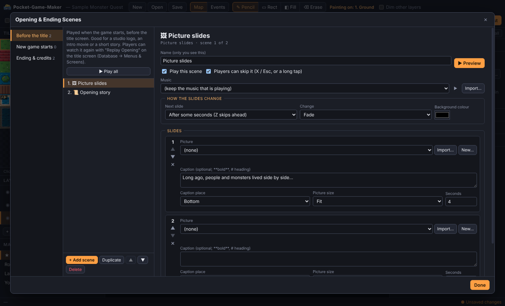

The sample game opens with a short story over a night sky, and its ending list has a thank-you page and a credits roll.

## 6. Importing your own art

To add your own files, click **Import** in the toolbar (or **File → Import Assets…**, `Ctrl+I`). The Import window has a card for each kind of file: tilesets, characters, monster pictures, battle backgrounds, pictures, music, sound effects and text. Each card shows how many are already in the project. Click **Import…** on a card and choose one or more files. They're copied into the project's `assets` folder, so the originals stay where they are, and each is added to Database → Credits as Custom, ready for you to fill in where it came from and its licence. When you import tileset images, Pocket-Game-Maker offers to add them to Database → Tilesets straight away; pick the tile size and click **Add to Database**. The Asset Library window has an **Import your own…** button that does the same for the kind you're looking at.

Every image setting also has a dropdown of the files already in the project and its own **Import…** button, which imports and selects the file in one go. Importing a file with the same name as an existing one replaces it everywhere it's used. Use PNG files with transparent backgrounds. Music and sound settings work the same way, with MP3 or FLAC files.

| Kind | Folder | Where you choose it |
| --- | --- | --- |
| Tilesets | `assets/tilesets` | Database → Tilesets |
| Characters | `assets/characters` | Event pages; System → Player |
| Monsters | `assets/monsters` | Database → Monsters → Sprites |
| Battle backgrounds | `assets/battlebacks` | Map inspector; System; Trainer battle command |
| Music and jingles | `assets/music` | Database → Music & sounds; map inspector; Play music; Trainer battle command |
| Sound effects | `assets/sounds` | Database → Music & sounds; Play sound command |
| Pictures | `assets/pictures` | Menus & screens (title background); Show picture cut-scene command |
| Decorations | `assets/decorations` | Items of the kind Decoration (section 10): furniture facing down, 16 pixels per square |
| Text (.txt or .md) | `assets/text` | Menus & screens (credits and licence files) |

### Tilesets

- A tileset is a grid of square tiles with no gaps. Any number of rows and columns works; the image's width and height should be whole multiples of the tile size.
- Maps remember each tile by its position in the image, counting left to right and top to bottom. **Add new tiles at the end or in new rows at the bottom.** Inserting a tile in the middle shifts every tile after it and scrambles maps that already use the tileset.
- After importing, set the **Tile size** and flag passability and encounter tiles (section 5).

### Character sheets

One character per file, laid out as **3 columns × 4 rows** of equal-sized frames:

|  | Column 1 | Column 2 | Column 3 |
| --- | --- | --- | --- |
| Row 1 | Walking down, step | Facing down, standing | Walking down, other step |
| Row 2 | Walking left, step | Facing left, standing | Walking left, other step |
| Row 3 | Walking right, step | Facing right, standing | Walking right, other step |
| Row 4 | Walking up, step | Facing up, standing | Walking up, other step |

The frame size is the image width ÷ 3 by the height ÷ 4, so a 48×64 image has 16×16 frames. Frames can be taller than a tile, such as 32×48 on 32 px tiles; they're drawn standing on the bottom of the square and centred across it.

This is RPG Maker's single-character layout (MZ files whose names start with `$`), so those import directly. MZ's standard sheets hold 8 characters (12 × 8 frames); cut those into one character per file first.

### Monster sprites

- Each species needs a **front** image (how it looks as an enemy) and a **back** image (how your own monster looks).
- Any size works. Square images with transparent backgrounds, such as 64×64, 96×96 or 128×128, look best.
- Sprites are fitted into the battle scene standing on their platform, and shrink a little in double and triple battles to fit.

### Battle backgrounds

- Any image; it's stretched to cover the whole battle screen, so match your screen's shape (4:3 for 320×240).
- Pocket-Game-Maker draws the platforms the monsters stand on itself, so leave them out of your background or they'll appear twice.
- Set a default in **System**, override it per map in the inspector, or per trainer in the Trainer battle command.

### Drawing your own: art templates

Pocket-Game-Maker comes with a template for every kind of art it uses, so your pictures come out the right size and the right way round. Open them with **Help → Art Templates…** or the **Open art templates…** button at the top of the Import window. They are copied to `Documents\Pocket-Game-Maker\Art Templates` the first time the app starts.

There are two kinds of file:

- **…-template.png** is the exact size the game expects, shaded in light squares: one shade for each tile or animation frame. It is meant to sit under your drawing, not to be drawn on directly.
- **…-guide.png** is a large, labelled picture that explains the layout, with a real example from the asset library next to it.

**How to use a template**

1. Open the template in your art program (Clip Studio Paint, Aseprite, Krita, Photoshop, GIMP and so on).
2. Add a new layer above it and draw on that layer.
3. Hide or delete the template layer, so the background is transparent.
4. Save or export as PNG, keeping the same size as the template.
5. In Pocket-Game-Maker, choose **Import** and the matching kind of art.

| Template | Size | What it is for |
| --- | --- | --- |
| `tileset-16px-template.png` | 128 × 128 | A tileset with 16-pixel squares, 8 across. Plain tiles at the top, an animated tile in green, four autotile blocks in blue. Add rows as you need them. |
| `tileset-32px-template.png` | 256 × 256 | The same with 32-pixel squares. |
| `autotile-16px-template.png` | 32 × 48 | One autotile block (water, paths, cliffs, fences): the top-left square is the one you paint with, the top-right holds the inside corners, and the lower 2 × 2 is one patch with its edges and corners. Same layout as RPG Maker's A2 autotiles. |
| `autotile-animated-16px-template.png` | 128 × 48 | An animated autotile: up to four blocks side by side, one per frame. |
| `character-16px-template.png` | 48 × 64 | People, objects and walking monsters: 3 frames across (step, standing, step) and 4 rows (facing down, left, right, up). The orange line is where the feet go. |
| `character-16x24px-template.png` | 48 × 96 | Taller characters (16 × 24 frames). They stand on their square and grow upwards. |
| `character-32px-template.png` | 96 × 128 | Big characters (32 × 32 frames). |
| `monster-64px-template.png` | 64 × 64 | A monster's front or back battle picture. Stand it on the orange line, centred. |
| `monster-96px-template.png` | 96 × 96 | The same with more detail. |
| `decoration-1x1` to `3x2-template.png` | 16 px a square | Furniture for Decorating, drawn facing down (as seen from the front of the room). A 2 × 1 table is 32 × 16. |
| `clothing-overlay-16px-template.png` | 48 × 64 | Clothes for the Wardrobe, with the hero shown faintly so the clothes line up. Draw only the clothes. |
| `battleback-320x240-template.png` | 320 × 240 | A battle background, showing where each side's monster stands and the message box at the bottom. |
| `screen-320x240-template.png` | 320 × 240 | Title screens and cut-scene pictures. |

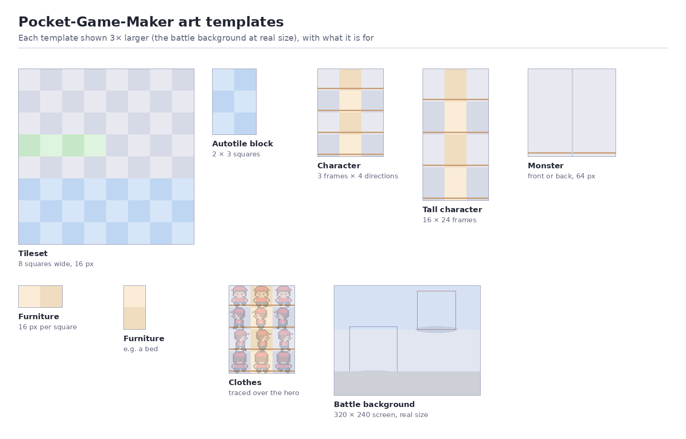

Animated tiles and autotiles are set up after importing, in **Database → Tilesets**: select the first frame (or the top-left square of an autotile) and set **Frames**, or tick **Autotile**. Whether a square blocks the player, has wild monsters or is drawn above the player is also set there, not in the picture.

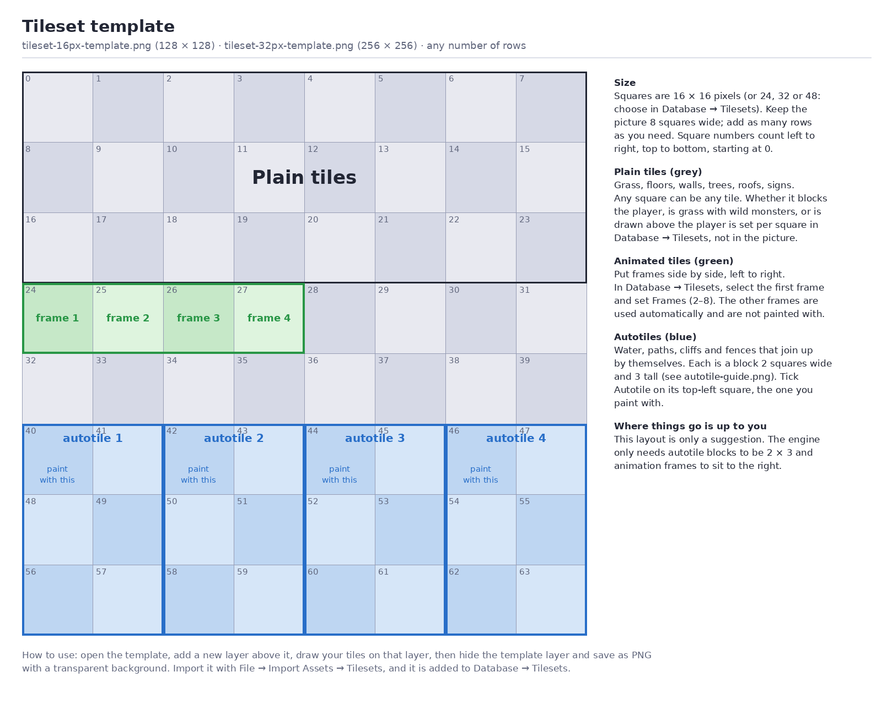

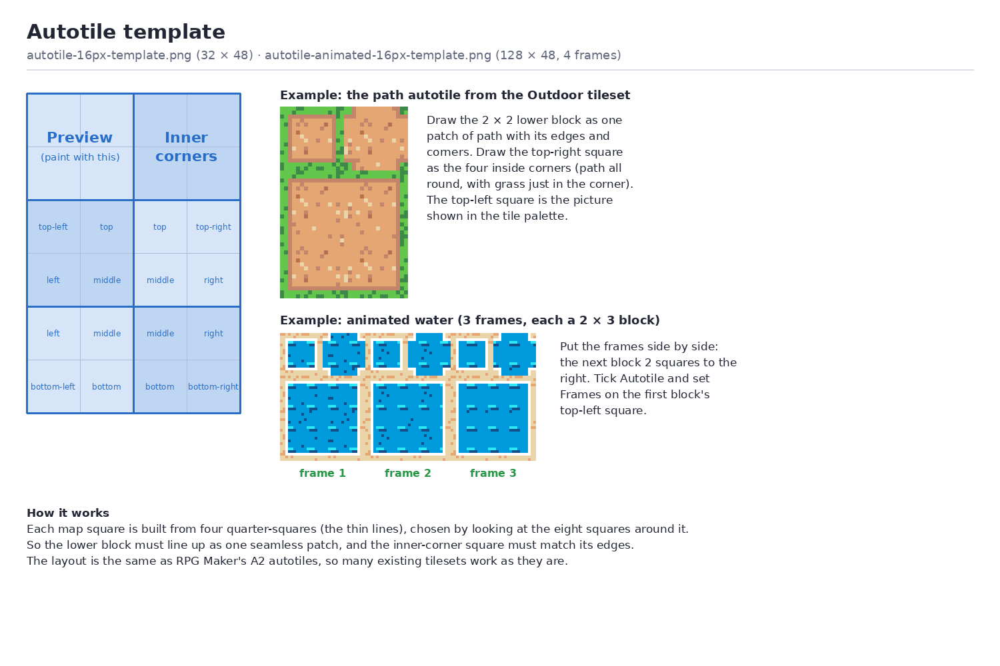

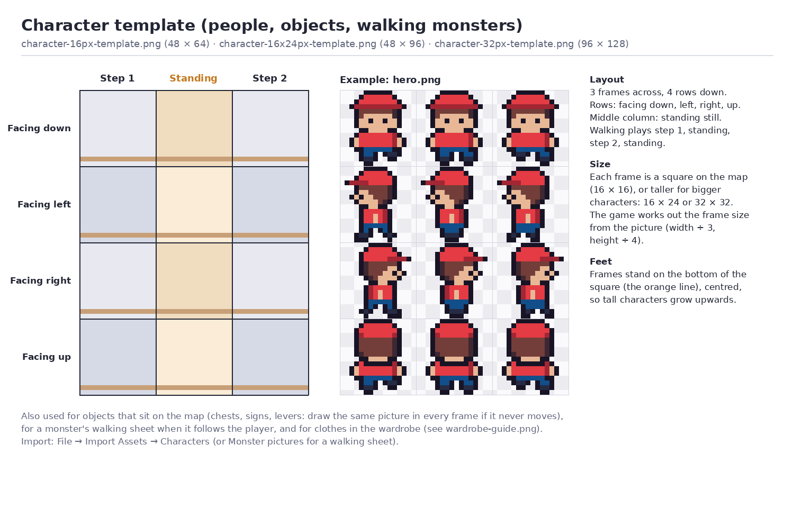

The Art Templates folder also has guides for monster pictures, furniture, clothes and battle backgrounds, and `overview.png` with every template together.

### The pixel editor

You can also draw and edit pictures without leaving Pocket-Game-Maker. Click **Draw** in the toolbar (or **Tools → Pixel Editor: New Picture…**, `Ctrl+Shift+N`), choose what you are drawing and give it a name. The picture starts at the right size, with its grid and the matching art template underneath as a guide.

To change a picture that is already in the project:

- **✎** on the **Tileset** panel edits the current map's tileset.
- Every picture picker (in the Database and the event pages) has **New…** and **✎ Edit** buttons next to **Import…**.
- Each card in the Import window has **Draw new…**.

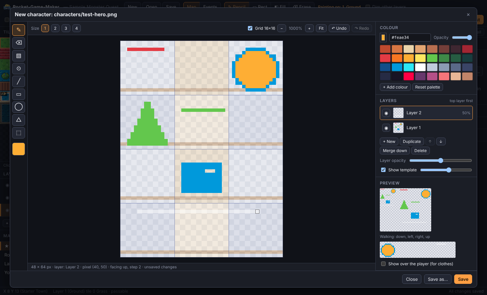

**Tools**

| Tool | Key | What it does |
| --- | --- | --- |
| Pencil | `B` | Draws in the current colour, 1 to 4 pixels wide (`[` and `]` change the size). Shift+click draws a straight line from the last point; right-click erases. |
| Eraser | `E` | Makes pixels transparent. |
| Fill | `G` | Fills the touching pixels of the same colour on the current layer. |
| Colour picker | `I` | Takes a colour from the picture. Alt+click does the same with any tool. |
| Line | `L` | Hold Shift to keep it straight or at 45°. |
| Rectangle | `U` | Hold Shift for a square. |
| Circle / ellipse | `O` | Hold Shift for a circle. |
| Triangle | `T` | Drag downwards for a triangle pointing up, upwards for one pointing down. |
| Select | `M` | Drag to select an area, then drag inside it to move it. Copy, cut and paste (`Ctrl+C`, `Ctrl+X`, `Ctrl+V`), `Delete`, flip, rotate and select all (`Ctrl+A`). `Enter` or `Esc` drops it in place. Pictures copied in other programs can be pasted in too. |

Shapes are drawn as an outline or filled: tick **Filled** above the picture or press `X`. While something is selected, drawing stays inside the selection.

**Colours.** The palette starts with the asset library's 32 colours. Click **+ Add colour** to keep the current one, or right-click a colour to remove it; the palette is saved with your project. Use the colour box for any other colour, and the **Opacity** slider for see-through colours. Colours you have used recently are listed underneath.

**Layers.** **+ New** adds a layer above the current one. You can also duplicate, hide (the ◉ button), rename (double-click the name), change the opacity, move a layer up or down, merge it into the one below, or delete it. **Show template** turns the guide on or off; it is never saved in your picture.

**Moving around.** Zoom with the mouse wheel or the **−** and **+** buttons, and click **Fit** (or press `0`) to see the whole picture. Pan with the middle mouse button or by holding Space and dragging. `#` turns the grid on and off. Undo and redo with `Ctrl+Z` and `Ctrl+Y`.

**Previews.** The **Preview** panel shows the picture at its real size, plus:

- **Character sheets** walking in all four directions. For clothes, tick **Show over the player** to see them worn.
- **Tilesets:** any autotile block joined up as a small lake, inside corners included, so you can check the edges meet. Type the number of the block's top-left square; the status bar shows the number of the square under the mouse.

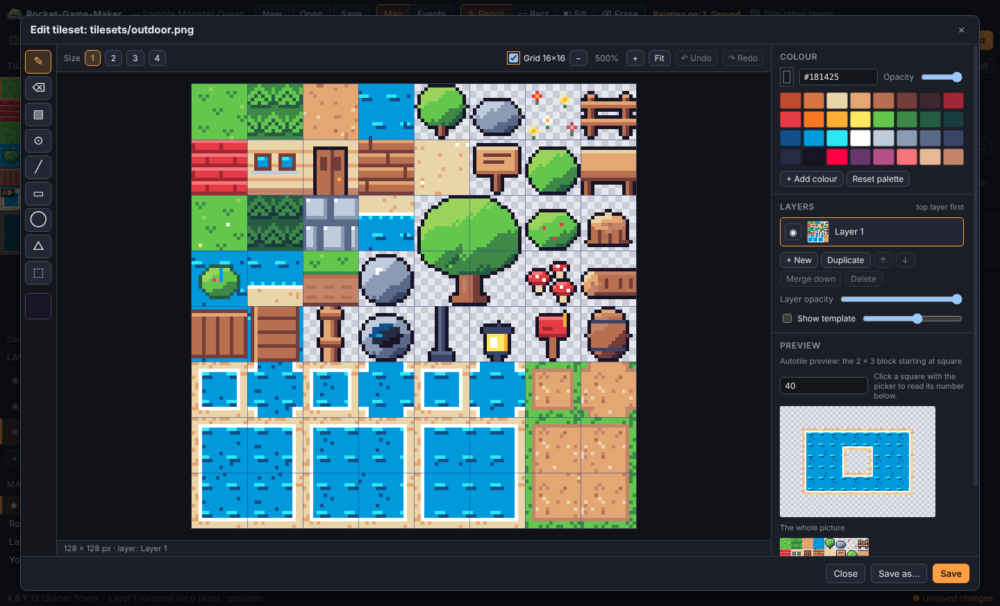

**Saving.** **Save** (`Ctrl+S`) writes the PNG into the project's `assets` folder, where the game uses it, and the map and Database show the change straight away. A new picture is added to Database → Credits as **Custom**, and a new tileset can be added to Database → Tilesets in the same step. The layers are kept in the project's `art-src` folder, so they are still there the next time you open the picture. Exported games don't include that folder. **Save as…** saves a copy under a new name.

## 7. The free asset library

Pocket-Game-Maker comes with a library of original pixel art that you can use in any game, free or paid, without asking permission or giving credit. Click **Assets** in the toolbar (`F10`) to browse it and add pieces to your project.

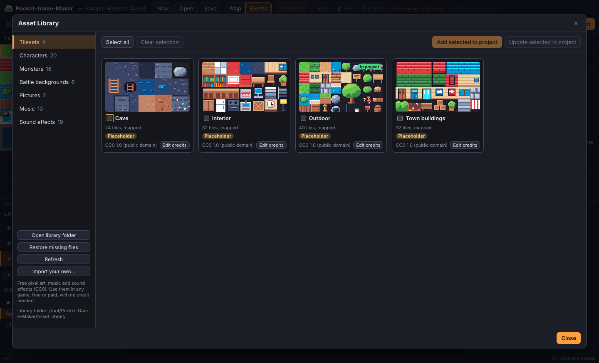

| Kind | What's included |
| --- | --- |
| Tilesets (16 px tiles) | Outdoor (64 tiles, including an animated water autotile and a dirt path autotile), Town buildings (32), Interior (32), Cave (24) |
| Characters | Hero, Heroine, Professor, Healer, Shopkeeper, Rival, Youngster, Lass, Hiker, Old man, Villager, Twin, Ace trainer, plus a capture orb, treasure chest, boulder, sign post and a lever (off and on) for events |
| Monsters | 16 species with front and back sprites: the 10 in the sample game plus Flitwing, Gloomshade, Crabble, Mossnail, Batling and Glimmerfox |
| Battle backgrounds | Field, Forest, Town, Beach, Cave, Indoor |
| Music | Dawn of Adventure (title), Sunny Town, Open Road (routes), Echoing Depths (caves), Wild Clash (wild battles), Rival Showdown (trainer battles), Victory Fanfare, and three jingles: Rest Well, Found It! and New Friend |
| Sound effects | 20 effects for menus, battles, catching, doors, shops, saving and jumping down ledges |
| Pictures | A sunrise over green hills for a title screen, and a starry night sky for cut scenes |

### Adding assets to your project

1. Click **Assets**, then choose a tab on the left: Tilesets, Characters, Monsters, Battle backgrounds, Music or Sound effects. Music and sound cards have a ▶ button to listen.
2. Tick the items you want, or click **Select all**.
3. Click **Add selected to project**. Items already in your project show an **In project** badge.
4. Use them like any other image. A new tileset appears in **Database → Tilesets** with its tile settings already filled in; pick it for a map in the map inspector.

**Update selected in project** replaces your project's copies with the library versions. Use it after you've changed something in the library. New projects include the whole library when **Include the free asset library** is ticked in the New project window.

The four extra monsters only come as sprites. To use one, add it from the Monsters tab, then create the species in **Database → Monsters** and pick its sprites.

### Tile mappings

Every library tileset comes with a **mapping file** that gives each tile a name and its settings: whether the player can walk on it, whether wild monsters appear on it, whether it's drawn above the player, and which layer it's meant for. When you add a tileset, these settings are copied into your project, so you can start painting straight away.

- Point at a tile in the palette to see its name and settings, which also appear in the status bar as you move over the map.
- In **Database → Tilesets**, the **Tile names** mode lets you click a tile and rename it.
- Most objects, such as trees, rocks, signs and furniture, have transparent backgrounds. Paint them on the **Obstacles** layer on top of grass, paths or floors. Flowers and tall grass go on **Grass & overhead**.

Some objects are made of several tiles. Paint the pieces like this:

| Object | Tileset | Top tiles | Bottom tiles |
| --- | --- | --- | --- |
| Big tree (2×2) | Outdoor | Grass & overhead layer, so the player walks behind it | Obstacles layer, blocks the player |
| Lamp post (1×2) | Outdoor | Grass & overhead layer | Obstacles layer |
| Bookshelf (1×2) | Interior | Obstacles layer | Obstacles layer |
| Bed (1×2) | Interior | Obstacles layer | Obstacles layer |

### Changing the library later

The library is an ordinary folder on your computer: `Documents\Pocket-Game-Maker\Asset Library`. Click **Open library folder** in the Asset Library window to go straight there. Anything you change or add appears in the Asset Library window after you click **Refresh**.

- **Edit an image** in any art program, such as Clip Studio Paint or Aseprite. Keep the same tile size and grid, and add new tiles at the end of a tileset, never in the middle.
- **Add your own art** by saving PNG files into the matching folder: `tilesets`, `characters`, `monsters` (as `name_front.png` and `name_back.png`) or `battlebacks`.
- **Save tile settings back to the library:** set them in **Database → Tilesets**, then click **Save settings to library**. Other projects can then use **Load settings from library** to pick them up. This also works for your own tilesets.
- **Undo a mistake:** delete the file you broke and click **Restore missing files**. It puts back any original file that's missing and never overwrites your changes.

Your projects keep their own copies of every image, so changing the library never changes an existing game until you click **Update selected in project**.

### Asset origins and licences

Pocket-Game-Maker keeps a list of where every image came from and what licence it's under, so you always know what can go in a finished game. For now every library asset is marked **Placeholder**: original Pocket-Game-Maker art by project-tech-me, released as CC0 (public domain). As you replace pieces with your own art, update their entries.

Each entry records:

| Field | What to put in it |
| --- | --- |
| Status | **Placeholder** for built-in art you plan to replace, **Custom** for art made by you or for you, **Third-party** for art from another artist or asset pack |
| Origin | Where it came from, such as "drawn by me", a pack name and website, or the exact credit line an artist asks for |
| Author | Who made it |
| Licence | The licence it's under, such as CC0, CC BY 4.0, a purchased licence, or "All rights reserved" for your own work |

There are two lists:

- **The library's list.** Every card in the Asset Library window shows its status and licence. Click **Edit credits** on a card to change them. Pocket-Game-Maker rewrites `CREDITS.md` (easy to read) and `credits.csv` (opens in Excel) in the library folder each time.
- **Each game's list.** Open **Database → Credits** to see every image in the current project. Use the buttons at the top to show only Placeholder, Custom, Third-party or **Not recorded** images, and type straight into the table to change an entry. Each time you save, it's written to `CREDITS.md` in the project folder, ready to copy into your game's credits.

Entries are filled in for you whenever possible. Assets added from the library bring their credits with them. Images you bring in with **Import…** are recorded as Custom with the licence *Not set* until you fill it in.

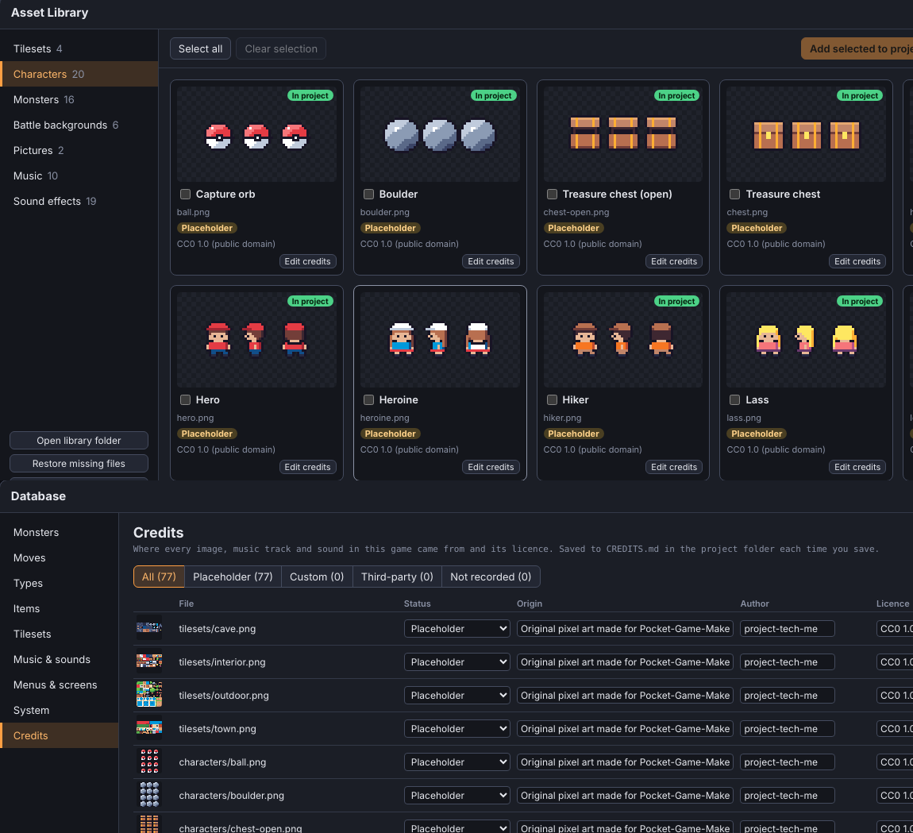

Before you release a game, open **Database → Credits**, click **Not recorded**, and make sure the list is empty. Then check that any Third-party art's licence allows the way you're releasing the game.

## 8. Playtesting and the game

**▶ Playtest** (`F5`) opens your game in its own window using exactly what's in the editor now, so you don't need to save first. If something would break the game, such as no player sprite or a monster missing a sprite, Pocket-Game-Maker lists it first and lets you play anyway.

- A normal playtest starts at the **title screen** you set up in Database → Menus & screens: New Game, Continue from a save, and, if you turned them on, Credits, Licence and Quit. On the Credits and Licence screens, use the arrow keys to scroll and X to go back.
- **Playtest from here** (right-click a square in Events mode) skips the title and starts a new game on that square. It's the fastest way to test one area.

### Controls

| Key | Action |
| --- | --- |
| Arrow keys or WASD | Move; move the cursor in menus |
| `Z`, `Enter` or `Space` | Talk, inspect, confirm, next message |
| `X`, `Esc` or `Backspace` | Cancel, go back; opens the menu when walking |
| Hold `Shift` | Run at double speed |
| Hold `Ctrl` | Testing only: walk through walls and skip wild encounters |
| In a shop | Up and down change how many by 1, left and right by 10 |
| `F12` | Playtest only: save a 1920×1080 screenshot in the project's screenshots folder |
| `F11` or `Alt+Enter` | Exported Windows and Linux games: full screen on or off |

The mouse works too: click menu options and message boxes.

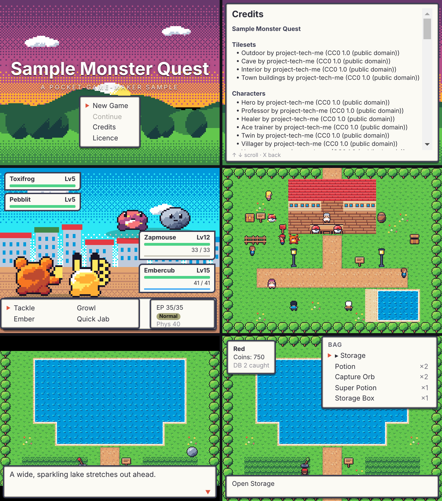

### Battles

Enemy monsters stand top right with their name, level and HP bar top left. Yours stand bottom left, with HP numbers and an experience bar bottom right. In double and triple battles each side has several monsters out, and you choose an action for each of yours in turn.

| Command | What it does |
| --- | --- |
| **Fight** | Choose a move. The box on the right shows its EP, type and power. With more than one possible target, choose one; an arrow points at it. |
| **Bag** | Use a battle item on one of your monsters, or throw a ball at a wild monster. |
| **Monsters** | Swap the active monster for one in your party. Uses the turn. |
| **Run** | Try to escape. Works against wild monsters only, unless the System tab allows running from trainers. A faster monster always escapes, and each failed attempt makes the next more likely. In doubles, later monsters show **Back** here to change an earlier choice. |

**Turn order:** switches happen first, then items, then moves. Moves go in priority order, then fastest first.

**Damage** depends on the attacker's level, the move's power, Attack against Defense (or Sp. Atk against Sp. Def), 1.5× for using a move of its own type, type effectiveness, a 1-in-24 critical hit worth 1.5×, and a random 85–100% spread. Stat stages from moves like Growl change the stats by up to −6 or +6.

**Status problems**

| Status | Effect |
| --- | --- |
| Poison (PSN) | Loses 1/8 of max HP at the end of each turn. |
| Burn (BRN) | Loses 1/16 of max HP each turn, and its physical attacks do half damage. |
| Paralysis (PAR) | Half Speed, and a 1-in-4 chance it can't move each turn. |
| Sleep (SLP) | Can't move for 1–3 turns. |

### Catching monsters

Throw a ball from **Bag** during a wild battle. The lower the monster's HP, the better the chance; sleep doubles it and other status problems add half again. The species' catch rate and the ball's multiplier matter too. The ball shakes up to three times before it either breaks open or clicks shut.

You can't catch a trainer's monster. In a horde of several wild monsters you can only throw once a single one is left. A caught monster joins your party, or goes to Storage if the party is full.

### Experience, new moves and evolution

When an enemy faints, every monster of yours that fought it shares the experience; trainer battles give 1.5×. When a monster levels up it learns any new moves from its learnset. If it already knows four, after the battle you're asked whether to forget one. If it reached its evolution level, it evolves after the battle.

### Losing

If all your monsters faint, you **black out**: your team is healed, you lose half your money, and you wake at the blackout point set in the System tab.

### The menu

Press `X` or `Esc` while walking.

| Option | What it does |
| --- | --- |
| **DB** | Every species: ● caught, ○ seen, and ----- for ones you haven't met. |
| **Monsters** | Your party with HP and status. Choose one for its **Summary** (stats, moves, EP, exp to next level; ← → flips between monsters) or **Switch** to reorder. The first healthy monster leads in battle. |
| **Bag** | Use healing, revive, EP and evolution items on your monsters, and tools such as the Storage Box. Any bag shortcuts appear at the top. |
| **Storage** | **Withdraw** monsters into your party or **Deposit** them. Deposited monsters are fully healed. You must keep at least one healthy monster in your party. |
| **Save** | Save to one of four slots. Saves live in the project's `saves` folder; Continue on the title screen loads them. |

These are the sample's menu entries. Each game chooses its own in Database → Menus & screens: which entries appear, what they're called and in what order.

### The following monster

If following is turned on (Database → Menus & screens), the first monster in your party walks one step behind you, and comes along when you change map. Face it and press Z to see how it's feeling. Reorder your party to choose who follows; a fainted monster stays in its ball until it's healed.

## 9. Recipes for common setups

Each recipe below is used in the sample project, so you can open it in Events mode to see a working copy. For treasure chests, items on the ground and signs, a quick event (section 4) builds the same thing for you in one step.

### An item lying on the ground (picked up once)

1. Create an event where the item should be.
2. **Page 1**: sprite `ball.png`, trigger **Action button**. Commands: **Show text** "You found a Great Orb!", **Give item** Great Orb ×1, **Set self switch** ON.
3. **+ New page**. **Page 2**: condition **Self switch is ON**, no sprite, no commands.

After pickup, page 2 takes over, and with no sprite the item has gone. Example: the item orb on Route 1.

### A trainer who spots you

1. **Page 1**: the trainer's sprite, **Facing** the way they watch, trigger **Trainer sight**, **Sight range** 3–5.
2. Commands: **Show text** (their challenge line), **Trainer battle** (name, party, prize, defeat and victory lines), **Set self switch** ON.
3. **Page 2**: condition **Self switch is ON**, same sprite and facing, trigger **Action button**, one **Show text** for what they say afterwards.

Example: Youngster Joey on Route 1.

### A double battle

Make the trainer as above, but set **Active per side** to **2** in the Trainer battle command and give them at least two monsters. To make every trainer battle a double, set **Trainer battle size** to 2 in Database → System → Battle rules instead. Example: the Twins on Route 1.

### A map exit or door

1. In Events mode, right-click the exit square and choose **Quick event: Exit / door**.
2. Choose *Walk onto the square*, then the destination map, square and facing.
3. Land the player one square inside the new map, not on its return exit, or they'll bounce straight back.

To do the same by hand: an event with no sprite, trigger **Player touch**, **Walk-through** ticked, and a **Transfer player** command.

Example: the south exits of Route 1. The north exit of Starter Town is built by hand, because it also blocks the way until you have a monster (see below).

### Choosing a starter

1. Create one event per starter, each with sprite `ball.png` and trigger **Action button**.
2. **Page 1** commands: **Show text**, **Give monster** (the starter at level 5), **Set switch** "Chose starter" ON, **Set self switch** ON.
3. **Page 2**: condition **Switch** "Chose starter" ON. Text: "You already chose your partner."
4. **Page 3**: condition **Self switch is ON**, no sprite, no commands, so the chosen orb disappears.

Page 3 beats page 2 because it has the higher number, which is why the chosen orb vanishes while the others stay.

### Blocking a route until something happens

1. On the exit, **Page 1** (no conditions, Player touch, Walk-through): **Show text** "You shouldn't go without a monster!" then **Transfer player** one square back on the same map.
2. **Page 2** (condition: switch "Chose starter" ON, Player touch, Walk-through): the real **Transfer player**.

Example: the north exit of Starter Town.

### A healer

One page with a sprite, trigger **Action button**, and commands **Show text**, **Heal party**, **Show text**. Example: the Healer in Starter Town.

### A one-off special monster

An event with the monster's sprite, trigger **Action button**, commands **Wild battle (scripted)** then **Set self switch** ON, and a second page with the self-switch condition and no sprite. The monster disappears after the battle whether the player catches it, defeats it or runs away.

### Joining two maps edge to edge

1. Leave a gap in the trees or walls on the side of each map where the player should cross.
2. Select the first map and, in the inspector's **Map edges**, pick the second map for that edge. The second map is linked back automatically.
3. If the gaps aren't at the same position on both maps, set the shift number so they line up.

Example: the top of Route 1 and the bottom of Lakeside.

### A shop

Right-click a square in Events mode and choose **Quick event: Shopkeeper**. Add the items to sell, and tick *Player can sell items here* if the shop should buy things too. Example: the shopkeeper at the bottom of Starter Town.

### Asking a question

Add a **Yes / No choice** command. Put what happens on "Yes" in the first list and what happens on "No" in the second. For a nurse who asks before healing, put **Heal party** in the first list and a goodbye message in the second. Example: the Villager in Starter Town.

### Music for a place

Pick the map's music under **Music** in the inspector. For a house inside a town, choose *Keep the music that's playing* so the town music carries on. To change the music in the middle of an event, such as when a rival appears, use **Play music**.

### A person who gives a present

Right-click a square in Events mode and choose **Quick event: Person (NPC)**. Set *What they do* to **Give an item (once)**, choose the item, and write what they say before and afterwards. Example: the Gardener in Starter Town.

### A trainer who walks a route

Make a **Person (NPC)**, set *Movement* to **Walk a set route** and pick a preset such as *Back and forth: left ↔ right*, then set *What they do* to **Battle the player (once)** with a sight range of 3–5. They spot the player whenever the player is in front of them. Example: Hiker Hugo on Route 1.

### A lever that moves a boulder

1. Add a **Switch / lever** quick event. It gets its own new switch.
2. Make the boulder an event with the boulder sprite on page 1.
3. Add a page 2 to the boulder with the condition **Switch is ON** (the lever's switch), no sprite and *Walk-through* ticked.

Pulling the lever turns page 2 on, so the boulder vanishes. Example: the lever and boulder at Lakeside.

### A cut scene

Add a **Cut scene** quick event and choose when it starts. Under **The scene**, keep **Built from your game** and add steps: for example **🎥 Camera** to pan to something interesting, **💬 Text**, a **❗ Bubble** over the player, then **🎥 Camera** again with *Back to the player*. Click **▶ Preview** to watch it. For a movie instead, choose **A movie file** and pick one. Example: arriving at Lakeside, or the TV in Your Room.

## 10. Decorating and the Wardrobe

Two optional features let players make the game their own: they can decorate their home with furniture they buy, and change the player character's clothes. Both are off until you turn them on in **Database → Menus & screens → Optional features for players**. The sample game has both on: go through the door of the house in the bottom-left corner of Starter Town.

### Setting up decorating

1. Tick **Decorating** in Optional features. To start quickly, click **Add the library's furniture as items**: it adds twelve pieces (bed, table, chair, sofa, rug, bookshelf, plant and more) to the project, each as an item.
2. Or make your own: in **Items**, set the kind to **Decoration (furniture for a home)** and fill in the picture, its size and how it behaves.
3. Open the map players can decorate (their room or house) and tick **Players can decorate this map** in its properties.
4. Sell the furniture in a shop, or give it with an event.

| Decoration setting | What it does |
| --- | --- |
| Picture (facing down) | An image from `assets/decorations`, one 16-pixel tile per square: a 2×1 table is 32×16. **Size from picture** fills in the size for you. |
| Width and height | How many squares it covers. Turning it a quarter turn swaps them. |
| Blocks the player | Furniture blocks; untick for rugs and mats. Players can walk over those, and put furniture on top of them. |
| Turning | Four quarter turns, flip left / right only, or can't be turned. |

In the game, **Decorate** appears in the menu on maps players can decorate, and decorations can be used straight from the bag. A cursor shows where the item will go, outlined in green if it fits and red if it doesn't. Move it with the arrow keys, press **R** to turn it, and press **Z** for **Place here / Turn / Cancel** (this works on touch screens too). Furniture can't go on walls, on events or on top of other furniture.

To change something later, face it and press **Z**, or choose **Decorate → Arrange**: **Turn** it, **Move** it, or **Put away** to send it back to the bag. Placed furniture is saved with the game, separately for each map.

### Setting up the Wardrobe

1. Tick **Wardrobe** in Optional features. **Add the library's clothes as items** adds three outfits, three caps, two shirts and a pair of trousers that fit the library's Hero.
2. Or make your own: in **Items**, set the kind to **Clothing (for the Wardrobe)**, choose its slot and pick its character sheet.
3. Choose what the player starts wearing, if anything. Starting clothes go into the bag.
4. Sell clothes in a shop, give them with an event, or put them in the starting bag.

| Slot | What the sheet is |
| --- | --- |
| Whole outfit | A complete character sheet (3 frames × 4 directions) that replaces the player's sprite |
| Top, Bottoms, Hat, Extra | A sheet the same size as the player's, transparent except for the clothing. They're drawn over the outfit in that order, so a hat sits on top of everything. |

In the game, **Wardrobe** in the menu (or using clothes from the bag) lists each slot with a turning preview of the player. Use ↑ ↓ to pick a slot and ← → to change what's worn. Clothes are never used up, a shop only sells each piece once, and selling clothes the player is wearing takes them off.

To open the Wardrobe from an event, such as a wardrobe in the player's room, use the event command **Open a screen**. It can also open Decorate, monster storage, the bag, the monster list, the monster database or the save screen.

## 11. Exporting your game

Export turns your project into games people can play without Pocket-Game-Maker: Windows, Linux and Steam Deck, web browsers and Android, plus upload scripts and store images for Steam, the Epic Games Store, itch.io, GOG and Google Play. Click **Export** in the toolbar, or **File → Export Game…** (`Ctrl+E`), fill in the details, tick what to make and press **Export**.

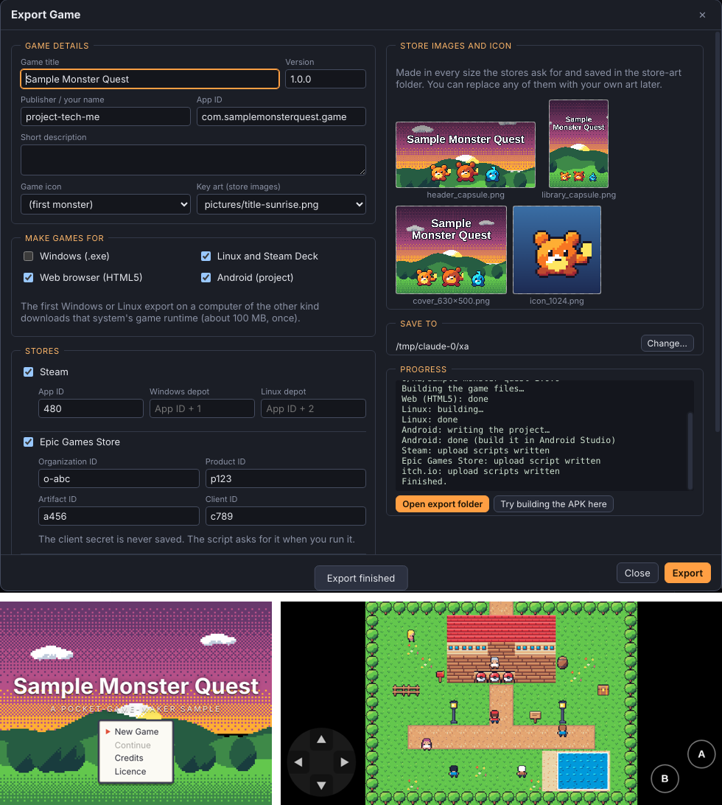

### Game details

| Setting | What it is for |
| --- | --- |
| Game title | The window title, file names and the title on store images |
| Version | Like 1.0.0. Raise it for every release: Android and the stores need a higher number each time |
| Publisher / your name | Written into the Windows .exe and the game's licence notice |
| App ID | A unique name like com.yourname.gamename. Android uses it to tell apps apart, so never change it after release |
| Short description | Shown in the Linux applications menu |
| Game icon | Any monster, picture or character sprite. Pixel art is enlarged without blurring. Left empty, the first monster is used |
| Key art | A wide picture behind the title on store images. The title screen picture is used to start with |

The settings are saved with the project. Everything is written to the project's `exports` folder (or a folder you choose with **Change…**), in a folder named after the game and version, such as `sample-monster-quest-1.0.0`.

### What you get

| Folder | What is in it |
| --- | --- |
| `windows/<Game>/` | `<Game>.exe` with its runtime, your icon and name built in. A zip of it is in `zips/` |
| `linux/<game>/` | The Linux program (also runs on Steam Deck), an icon and a `.desktop` menu entry. `zips/` has a `.tar.gz` that keeps it runnable |
| `web/` | The browser version. `zips/<game>-web.zip` is ready for itch.io |
| `android/<Game>/` | An Android project to build the app from (see Android below) |
| `steam/`, `epic/`, `itch/`, `gog/`, `google-play/` | Upload scripts and step-by-step notes for each store you ticked |
| `store-art/` | Capsules, banners, logos and icons in the sizes each store asks for |
| `RELEASE-CHECKLIST.md` | What to check before you release |

### Windows and Linux

- You can make both from either system. The first time you make the other system's game, Pocket-Game-Maker downloads its runtime (about 100 MB) from GitHub, checks it against Electron's published checksums and keeps it for next time.
- On Windows the .exe gets your icon, name and version. Exporting for Windows from Linux needs Wine for this; without it the .exe keeps the standard icon but works the same.
- Players unzip the folder and run the game. Saves go in their own app data folder. `F11` or `Alt+Enter` switches full screen.
- Exported games are not code-signed, so Windows may say "Windows protected your PC" the first time; players click **More info → Run anyway**. Games installed through Steam or another store launcher don't show this.

### Web browsers

- Upload `zips/<game>-web.zip` to itch.io and tick "This file will be played in the browser", or put the `web` folder on any website.
- The web build must be served by a web server: opening `index.html` straight from your disk shows a black screen. To try it on your computer, run `python -m http.server` in the `web` folder and open http://localhost:8000.
- Saves are kept in the player's browser, for that website only.
- On phones and tablets an on-screen direction pad and A / B buttons appear. Change this in **Database → Menus & screens → Touch screens** (automatic, always or never).

### Android

Pocket-Game-Maker writes an Android project; the app itself is built from it with Google's Android tools. There are three ways:

1. **Android Studio** (free): open the `android/<Game>` folder, then **Build → Build APK** to test on a phone, or **Generate Signed App Bundle** for Google Play.
2. **GitHub**: push the folder to a GitHub repository. The included workflow builds the APK and the bundle and attaches them to the run.
3. **Try building the APK here** in the Export window, if the Android SDK and Gradle are already installed on your computer.

The game runs full screen in landscape, the phone's back button works as cancel, and it targets Android 16 (API level 36, which Google Play requires from 31 August 2026) and runs on Android 7.0 and newer. For Google Play, make a signing key and fill in `keystore.properties` as the project's README.md explains. Keep the key safe: without it you can't update the game.

### Stores

| Store | Pocket-Game-Maker writes | You do |
| --- | --- | --- |
| Steam | SteamPipe build scripts and `upload-to-steam.bat` / `.sh` | Join Steamworks and create the app, enter its App ID and depots, run the script with steamcmd, set the launch options and set the build live |
| Epic Games Store | `upload-to-epic.bat` for Epic's BuildPatchTool | Enter your organization, product, artifact and client IDs from the Epic Developer Portal; the script asks for the client secret, which is never saved |
| itch.io | `push-to-itch.bat` / `.sh` for butler (Windows, Linux and web channels) | Create the game page, run `butler login` once, then the script. Or upload the zips by hand |
| GOG | Notes on what to send | Apply at GOG; it chooses which games it sells |
| Google Play | The steps to follow | Create the app in the Play Console and upload the signed .aab, to a testing track first |

Each store has its own sign-up, fees and rules, so check its developer site before you start.

### Store images

The store images are drawn from your key art, title and first three monsters: Steam's capsules (920×430, 462×174, 1232×706, 748×896, 600×900), page background (1438×810), library hero (3840×1240), logo and icons; Epic's 2560×1440 and 1200×1600 images, logo and icon; the itch.io cover (630×500); and Google Play's 512×512 icon and 1024×500 feature graphic. The background and hero images have no title, as Steam asks. Use them to get started and replace them with your own art when you can. For screenshots, press `F12` while playtesting: each one is saved at 1920×1080 in the project's `screenshots` folder.

## 12. Reference

### Editor keyboard shortcuts

| Key | Action |
| --- | --- |
| `Ctrl+N` / `Ctrl+O` / `Ctrl+S` | New project / Open project / Save |
| `F5` | Playtest |
| `F9` | Database |
| `F10` | Asset Library |
| `Ctrl+Shift+1` to `9` | Open a Database tab: Monsters, Moves, Types, Items, Tilesets, Music & sounds, Menus & screens, System, Credits |
| `Ctrl+I` | Import your own assets |
| `Ctrl+E` | Export Game |
| `M` / `E` / `H` | Map mode / Events mode / Height mode (2.5D) |
| `B` / `R` / `F` / `X` | Pencil / Rect / Fill / Erase |
| `1` to `9` | Paint on layer 1 to 9 |
| `D` | Dim other layers on or off |
| `P` | Show or hide passability |
| `Ctrl+Z` / `Ctrl+Y` | Undo / Redo |
| `Ctrl` + mouse wheel | Zoom the map |
| `Enter` / `Delete` / `Ctrl+C` | Edit / delete / copy the selected event (Events mode) |
| `Esc` | Close a dialog |

### Where your game is kept

Each game you make is one folder, in the place you chose when you created it. Everything about the game lives inside that folder.

- **To back up a game**, copy the whole folder somewhere safe, such as a USB stick or cloud storage. To restore it, copy it back and use **Open project…**.
- **To move a game to another computer**, copy the folder across and open it in Pocket-Game-Maker there.
- **Your images** are in the `assets` folder inside the game folder. Anything you import is copied there, so you can delete or move the originals.
- **Playtest saves** are in the `saves` folder. Delete the files in it to start with no saved games.
  - CREDITS.md lists every image in the game with its origin and licence. Pocket-Game-Maker rewrites it each time you save, from Database → Credits.
- Don't rename, move or edit the other files inside the folder by hand; use Pocket-Game-Maker to make changes.

### Troubleshooting

| Problem | Fix |
| --- | --- |
| Windows says it "protected your PC" | The installer isn't digitally signed, so Windows doesn't recognise it yet. Click **More info → Run anyway**. |
| The player walks through something they shouldn't | Turn on **Passability**. If the square isn't red, paint the object on a layer set to *Always blocks*, such as Obstacles. If its layer uses each tile's setting, flag the tile × in Database → Tilesets instead. |
| The player can't walk where they should | A red square means a layer blocks it: something is painted there on a layer set to *Always blocks* (look for hidden layers too), or a tile flagged × sits on a layer that uses each tile's setting. Erase it or move it to a walkable layer. An event with a sprite also blocks unless **Walk-through** is ticked. |
| No wild battles in the grass | Check the square has an encounter tile (♣) on a layer whose **Wild encounters** setting allows it, the map's encounter chance is above 0 and its table has monsters, and that you're not holding `Ctrl`. The party also needs a monster that can fight. |
| A trainer never notices the player | Check the page trigger is **Trainer sight**, the **Facing** points along the path, the **Sight range** reaches it and nothing blocks the line. The trainer won't trigger again once their self switch is on. |
| An event keeps repeating | An **Autorun** page runs again as soon as it ends. Have it set a switch or self switch that activates a later page. |
| The player bounces back through a door | The Transfer lands them on the destination map's exit event. Land them one square further in. |
| An imported sprite looks sliced or jumbled | Character sheets must be exactly 3 frames across and 4 down (section 6). |
| A map's tiles changed after editing the tileset image | Tiles were inserted in the middle of the image, shifting their numbers. Add new tiles at the end instead. |
| Playtest shows old art | Click **Import…** again, or close and reopen the project, so it reloads the files. |
| No music or sounds | Check Database → Music & sounds: the slot has a file and the volumes aren't 0. The map's Music may be set to Silence. Projects made before version 0.6 have no music until you click Add the free presets there. |
| Walking off the edge does nothing | Check the map's Map edges has a map for that side, and that the player can walk on the edge square. Holding Ctrl in a playtest also stops edges working. |
| An autotile shows the wrong edges | Each square joins with neighbours painted with the same autotile on the same layer. Paint the whole patch on one layer, and use an image laid out like RPG Maker's A2 autotiles (section 5). |
| A shop item can't be sold | Key items and items with no price can't be sold. Give the item a price in Database → Items. |
| A person on a route stops or skips steps | Something is in the way (a wall, another event or the player). They wait a moment and then skip the blocked step. Check the route in Events mode: the selected event's route is drawn on the map. |
| A cut scene plays every time | In the Cut scene window, set **Plays** to **Once** (scenes that start by themselves always play once). If you edit the event by hand, keep the Set self switch ON at the end of its commands and the empty second page with the self-switch condition. |
| No monster follows the player | Turn following on in Database → Menus & screens. The first monster in the party follows only while it hasn't fainted. |
| The exported web game shows a black screen | It was opened straight from the disk. Upload it, or run python -m http.server in the web folder and open http://localhost:8000. |
| Export stops while downloading the runtime | Check your internet connection and export again. The runtime comes from github.com; a damaged download is thrown away and fetched again. |
| The Windows .exe has the standard icon | It was exported from Linux without Wine. Install Wine, or export on Windows. The game works either way. |
| Windows says "Windows protected your PC" | The game isn't code-signed. Click More info, then Run anyway. Store launchers such as Steam don't show this. |
| The Linux game won't start | Run it from a terminal to see why. If the message mentions the sandbox, start it with ./\<game> --no-sandbox. |

### Not in this version yet

Coming in the next updates: day and night, seasons, held items, abilities, a character creator and more than one player character; then fishing, mining, foraging, farming, crafting and building, breeding and merging monsters. Also not yet: natures, variables (numbers that events can count with). Projects you make now will carry over as these are added.

---

Pocket-Game-Maker © 2026 project-tech-me. Released under the MIT Licence. Questions and feedback: project-tech-me@protonmail.com
